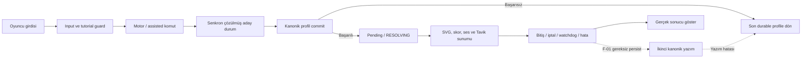

# Oyun çekirdeği / sunum sınırı denetimi

## Kapsam ve sonuç

Denetlenen güncel `main`: **`62c3fc1da82918bd7d39fcb4c04ece1aea26a39e`**, PR #25 sonrası. Audit dalı: `audit/game-core-presentation-boundaries`. İnceleme, kaynak izleme ve yeniden çalıştırılan testlere dayanır; önceki PR'ın yeşil sonuçları yeni koşum yerine kullanılmadı.

**Genel sahiplik doğru; yeni bir motor veya durum refaktörü gerekmiyor. Bir Orta önem düzeyinde sunum–kayıt bağımlılığı yeniden üretildi (F-01).** Bunun altında girdi engellenmesi, kazanma sunumunun atlanması ve koşullu yerel ölçüm kaybı var. Kanonik tahta kaybı, fazladan hamle/RNG geçişi, çift ödül veya ek can kesintisi yeniden üretilmedi.

Bu PR yalnız audit belgesidir. Motor, `app.js`, durum modülleri, test assertion'ları, kayıt sürümleri, ekonomi, canlar, ödüller, bölüm/varyant verileri, C# ve PWA değiştirilmez. F-01 bu PR'da düzeltilmiş değildir. Fiziksel iPhone/Android, Unity/IL2CPP ve native BFCache doğrulaması yapılmış sayılmaz.

Okunan mevcut sözleşmeler: [ARCHITECTURE](ARCHITECTURE.md), [STATE_ARCHITECTURE](STATE_ARCHITECTURE.md), [STATE_TRANSITION_MATRIX](STATE_TRANSITION_MATRIX.md), [STATE_REFACTOR_REPORT](STATE_REFACTOR_REPORT.md). Aşağıdaki satırlar denetlenen commit'e aittir; belgelerdeki genel ilkeler, gerçek kodun yerine kanıt kabul edilmedi.

## Mevcut sahiplik

| Veri / davranış | Yetkili sahip ve kod referansı | Sınırın değerlendirmesi |
| --- | --- | --- |
| Tahta, RNG, skor, katlar, tur ve sonuç | [engine.js:30](../dist/engine.js#L30), `status` 43–47, RNG 50, `swap` 142–159, snapshot 161 | Üç eksen, gravity/refill ve bütün zincirler aynı senkron motor komutunda çözülür. Render veya animasyon tamamlanması motor hesabı değildir. |
| Yardımlı oyun ve tekrar yürütülebilir komutlar | [commands.js:95](../dist/commands.js#L95), `apply` 99–138 | Preview klon üzerinde çalışır. ID tekrarı/conflict, limit ve hedef doğrulaması vardır. Başarılı komut sonunda model/usage/geçmiş birlikte güncellenir. |
| Varyant ve Attempt ID | `attempts.js`; [app.js:1082](../dist/app.js#L1082) `loadLevel` | Seçim RNG'si ayrıdır. UI operation ID, Attempt ID veya makbuz ID'sinin yerine geçmez. |
| Altın, yıldız, stok ve tamamlama hakları | `economy.js`; [app.js:1064](../dist/app.js#L1064) `markCompleted` | Kazanma hakkı gerçek komuttan sonra, kanonik commit öncesi hazırlanır. Sonuç düğmesini göstermek hak üretmez. |
| Can ve kurtarma makbuzları | `lives.js`, `rescue.js`, mevcut verifier/provider; [app.js:335](../dist/app.js#L335)–375, 667–674 | Aynı denemeye +5 ve tekil can/ödül sonuçları domain kurallarıdır. UI callback'i doğrulanmış makbuz değildir. |
| Kalıcı profil | [session-store.js:33](../dist/session-store.js#L33)–49; host [app.js:597](../dist/app.js#L597)–628 | Tek-yazıcı Web Lock + revision/CAS. Önce serialize ve tek kanonik `setItem`, sonra memory/revision. Uyumluluk aynalarının hatası başarıyı geri almaz. |
| Ekran/modal/lifecycle/geçici iş kimliği | `app-state.js`, `state-selectors.js`, `state-effects.js` | DOM'suz core profil tutmaz. Faz türetilir; native dialog, odak ve history adaptördedir. Settings hâlâ modaldır. |
| Geçici taş/skor/ödül hareketi | [app.js:1206](../dist/app.js#L1206)–1372, `board-view.js`, `score-presentation.js`, `rewards.js` / adapter | Görsel frame kopyaları ve `job.scoreDisplay` kanonik skor değildir. **Host finisher'ın `persist()` çağrısı F-01 istisnasıdır.** |
| Tavik, diyalog ve dünya | [app.js:82](../dist/app.js#L82)–100; `scene-presentation.js`, `tavik-dialogue.js`; `state-selectors.js:84–135` | Tek aktör projeksiyonu iki renderer'ı besler. Görsel decode/pose callback'leri yalnız DOM/yerel kaynaklarla çalışır. Kümes tamamlanan öğreticilerden türetilir; malzeme envanteri veya yıldız tabanlı ikinci ilerleme yoktur. |

`app.js` domain sahiplerini bir araya getiren composition root'tur. Komut çağırmak ve atomik işlemi koordine etmek, motor kurallarının UI'ya taşınması anlamına gelmez. Bağımsız yazılabilir `screen/paused/busy/modalStack` tekrar eklenmemelidir.

## Gerçek hamle yaşam döngüsü



1. Board girişi [app.js:1546](../dist/app.js#L1546)–1608 ve `board-input.js` ile hücre/yön olarak sınıflanır. `canRouteBoardInput`, mevcut sunumu açığa çıkaran dokunuşu yeni hamleden ayırır. `performSwap` 1374–1393 motor/öğretici doğrulamasını yapar; busy dokunuşu mevcut işi bitirip **return** eder.
2. `engine.swap` bütün dalgaları hemen çözer. Geçersiz komşu/eşleşme turn, RNG ve ödülü değiştirmez. `before` ve frame'ler yalnız görsel geri oynatım verisidir.
3. `startPresentation` 1399'da transient rezervasyon yapar. `markCompleted`, snapshot, can settlement ve terminal olay 1401'de aynı işlemin adayıdır. `commitSession` 1403 başarı vermeden gerçek görsel pending başlamaz. Assisted yol 468–488 aynı sınırı korur; inventory debiti ve komut sonucu birlikte saklanır.
4. `activatePresentation` sonrası renderer 1329–1363 ilk iki dalgayı gösterebilir; motor bütün dalgaları zaten çözmüştür. `score-presentation.js:22–36` yalnız `job.scoreDisplay` ve HUD'u değiştirir. `renderScore` 1190–1194 motor skoru atamaz.
5. Bitişte current job + epoch 1224'te doğrulanır. Controller, geçici taşlar, skor görevleri ve watchdog temizlenir. Sonuç zamanlayıcısı 1238–1239 ekran, epoch, pause, modal, visibility ve suspension kontrolü yapar. Callback ikinci `swap` çalıştırmaz.
6. Navigasyon 971–988 önce izin kontrolü yapar; sonra iş/hint/gesture/timer temizler, epoch ve navigation generation ile eski callback'leri emekli eder. `loadLevel` ayrıca 1085'te operation generation'ını geçersizleştirir.

### Engine WON, sunum RESOLVING aynı anda doğrudur

Motor durumu `score/ground/moves` üzerinden türetilir; UI tarafından yazılan ikinci bir kazanma alanı yoktur. Komut sonrası working engine henüz kaydedilmemişken bile `won` olabilir. UI rezervasyonu `requested` aşamasında giriş kilididir ve semantik faz PLAYING kalır; başarılı kanonik commit sonrası `pending` **RESOLVING** olur. Bu sırada kaydedilmiş engine **WON** olabilir. Görsel bitince selector WON gösterir.

Kod: [state-selectors.js:49](../dist/state-selectors.js#L49)–60, [app.js:1206](../dist/app.js#L1206)–1214. Çalıştırılan `check-state-operation-ui.cjs:59–72,112–125`, gerçek host'ta requested → commit → pending sırasını ve failed-write durumunda pending/ödül yayımlanmamasını kontrol eder. `GAME_RESULT_CONFIRMED` gibi ikinci bir otorite eklemek gerekli değildir.

## F-01 — Görsel bitişinin ikinci kanonik yazıma bağlanması

**Şiddet: Orta. Doğrulanmış; bu PR'da açık.** Alt etkisi olan isteğe bağlı yerel ölçüm kaybının şiddeti Düşük. Kanonik oyun/ekonomi bozulması veya kalıcı input kilidi iddiası değildir.

### Neden

- Hamle zaten [app.js:1403](../dist/app.js#L1403)'te; assisted komut 483'te başarıyla kaydedilir.
- `finishPresentation`, [1230–1231](../dist/app.js#L1230)'de tekrar `persist()` çağırır. Bu yalnız DOM temizliği değildir: 815–823 → 628 → 619–626 → `SessionStore.commit` ile yeni kanonik revision yazımıdır.
- Yalnız ikinci yazım hata verdiğinde catch son başarılı, **hamleyi içeren** durable kaydı yükler ama `lifeWriteFailed=true` yapar. [app.js:61–66](../dist/app.js#L61) bunu `writeBlocked` olarak giriş selector'ına verir. Depolama geri düzelse bile sonraki normal taş girdisi yok sayılır.
- Kazanılmış ana bölüm restore edilirken `restoreDurable` 614–617 tek-seferlik kampanya kuralları gereği sonraki bölüme yönlenir; bu fault yolunda gözlenen sonuç Home ve kapalı victory modalıdır. Kayıtlı ödül kaybolmaz; oyuncu kutlamayı görmez.
- `commitSession` 622'de `eventState=sessionEventBaseline` yapar. Bazı pointer akışlarında bu baseline başarılı hamleden öncedir. Sonraki başarılı focus yazımı, zaten saklanmış `level_completed` olayını geri sarabilir. Bu `hexrota-events-v1` yerel ölçüm kaybıdır; profil/RNG/Altın kaybı değildir. Araya document click girmesi baseline'ı yenileyebildiğinden bu alt etki bütün input taşıma yollarında genellenmez.

### Yeniden üretim

Gerçek uygulama host'u, gerçek motor, canonical store ve mevcut fixture'larla yapıldı; yalnız ikinci `hexrota-profile-v2` yazımına `QuotaExceededError` enjekte edildi. jsdom pointer olayları fiziksel dokunma diye sunulmaz.

Proje kökünde `npm ci` sonrası çalıştırılabilen asgari teşhis:

```sh
node <<'NODE'
const assert = require('node:assert/strict');
const {mount, existing, plain, enter, move} = require('./check-lives-ui.cjs');
(async () => {
  const f = mount({saved: existing(2, {turns: 1}).saved});
  let native;
  try {
    await enter(f);
    const expected = f.game(), pair = plain(expected.level.solution[expected.turn]);
    assert(expected.swap(...pair).ok);
    native = f.w.Storage.prototype.setItem;
    let writes = 0;
    f.w.Storage.prototype.setItem = function (key, value) {
      if (key === 'hexrota-profile-v2' && ++writes === 2)
        throw new f.w.DOMException('post-feedback failure', 'QuotaExceededError');
      return native.call(this, key, value);
    };
    await move(f, pair);
    assert.equal(writes, 2);
    assert.deepEqual(plain(f.game().snapshot()), plain(expected.snapshot()));
    f.w.Storage.prototype.setItem = native;
    await move(f, plain(expected.level.solution[expected.turn]));
    assert.equal(f.game().turn, expected.turn); // hata: sonraki geçerli girdi engelleniyor
    console.log({writes, turn: f.game().turn, toast: f.node('#toast').textContent});
  } finally {
    if (native) f.w.Storage.prototype.setItem = native;
    f.close();
  }
})().catch(error => {console.error(error);process.exitCode = 1;});
NODE
```

Bu teşhisin exit 0 vermesi **sağlıklı kabul kriterinin geçtiği anlamına gelmez**; mevcut kusurun ve korunan invariants'ın yeniden üretildiğini gösterir. Normal storage-failure testi ilk komut yazımını reddeder; burada ilk yazım başarılı, yalnız finisher'ın ek yazımı başarısızdır.

Gözlenen ayrıntılı kanıt:

| Vaka | Sonuç |
| --- | --- |
| jsdom: oynayan bölüm, 1 tur kayıtlı, click | İki yazma girişimi; revision 2→3; kesinleşmiş turn 2 aynen korunur; busy false. Storage geri yüklenip sonraki geçerli çift verildiğinde turn 3 yerine 2 kalır. Ekonomi/can değişmez. |
| jsdom: gerçek son komuta gönderilen sentetik pointer hareketi | Kesin won checkpoint/RNG/Attempt ID korunur; +20 Altın, +1 yıldız, tek `clear` ve can kesmeyen tek `won` life settlement. UI Home'a gider, victory kapalıdır; metin yanlış biçimde hamlenin geri alındığını söyler. |
| jsdom: başarılı focus/visibility toparlanması | Domain kayıt/ödül korunur, tekrar sonuç callback'leri yeni ödül vermez. Sentetik pointer vakasında yerel olay listesi `level_completed` içerirken toparlanma sonrasında boş olur. |

Aynı input engellenmesi **gerçek Chromium ve WebKit'te native touch girdisiyle ayrıca yeniden üretildi**: ilk commit'in exact turn 2 checkpoint'i/ekonomi/canı korundu, yalnız ikinci profil yazımı hata verdi, storage eski haline getirildikten sonra geçerli native hamle yok sayıldı; başarılı focus refresh sonrası aynı sonraki hamle işlendi. Bu iki browser teşhisi yerel ölçüm kaybı iddiası taşımaz. Teşhis raporları `findingObserved:true`, `healthyAcceptancePass:false`, `canonicalDataLoss:false` değerlerini açıkça ayırır.

Girdi kilidi kalıcı diye sınıflandırılmadı: başarılı focus/visibility profil yazımı veya reload `lifeWriteFailed` durumunu temizleyebilir. Depolamanın düzelmesi ve yalnız yeni taş girdisi verilmesi yeterli değildir.

### Önerilen dar değişiklik ve kabul koşulu

Ayrı bir fix PR'ında, görsel tamamlanmanın zorunlu olmayan `persist()` yolu domain commit'inden ayrılmalı. Bütün `persist`/rollback korumalarını topluca kaldırmak, receipt doğrulamasını UI'ya taşımak veya yeni bir transaction/state yöneticisi kurmak önerilmiyor. Hangi alanın gerçekten yeniden yazılmaya ihtiyacı olduğu önce doğrulanmalı; gerçek tercih/can/sağlayıcı değişimleri kendi işlem yolunda kalmalı.

Kabul: ilk yazım başarılı, sonraki yalnız görsel yazımı hata verdiğinde kesinleşmiş board/RNG/ödül/can/Attempt ID ve yerel terminal olay korunmalı; storage yeniden kullanılabilirken yeni hamle gereksiz bir recovery yazımına bağlı kalmamalı; kazanma sunumu yanlış rollback mesajıyla atlanmamalı. İlk **otoriter** komut yazımı başarısızsa mevcut tam rollback davranışı sürmeli.

## A–L tehlike matrisi

| Senaryo | Mevcut somut test / kod | Denetim sonucu ve kalıcı kapsam boşluğu |
| --- | --- | --- |
| A — Animasyon sırasında çift dokunma | `check-input.cjs:113,235`; `check-swap-lifecycle.cjs:55`; busy erken dönüşleri `app.js:1378,1419,1549` | Aynı gesture tek komut; resolving dokunuşu yalnız mevcut sonucu gösterir. Literal hızlı çift dokunma birleşimi için geçici audit probe'u ayrıca çalıştırıldı; standart suite'e kalıcı ekleme önerilir. |
| B — Zincir ortasında doğrudan Mola | `check-state-characterization.cjs:119`, `check-state-browser.cjs:76` hidden→pause; `check-menu.cjs:118` settled pause | Mevcut kalıcı testler iki davranışı ayrı kontrol ediyor. Geçici probe beş dalgalı gerçek komutun ikinci görsel dalgasında doğrudan Pause'a basar. |
| C — Animasyon bitmeden Home | `check-menu.cjs:157` kazanma/busy→Home→1.350 ms; `check-swap-lifecycle.cjs:74` | Exact checkpoint korunur, eski victory modalı menü üstüne gelemez. |
| D — Pending callback ile bölüm değiştirme | `check-state-characterization.cjs:147`; `check-input.cjs:264`; `app.js:1085,1483–1516` | Eski hint/animasyon current job + engine + epoch + operation generation ile elenir. |
| E — Animation API hatası | `check-state-browser.cjs:79`; `check-input.cjs:208`; `check-swap-lifecycle.cjs:92` | Throw/reject/ikinci geçici taşı oluşturma hatası kesinleşmiş hamleyi bozmaz. İptal/cleanup başka komut çalıştırmaz. |
| F — Kazanma animasyonu sürerken gerçek reload | `check-state-lifecycle.cjs:10`, browser144 sentetik pagehide; `check-attempt-ui.cjs:132` sonuç sonrası remount | Bunlar actual mid-win reload'un aynısı değildir. Çalıştırılan geçici audit probe gerçek `page.reload` kullanır. Kalıcı regression önerilir. Beklenen `game.current`, tamamlanan bölüm yerine sonraki açık bölümdür; eski won checkpoint/Attempt/ödül korunmalıdır. |
| G — Profil commit hatası | `check-state-operation-ui.cjs:112`; characterization106; browser70; `check-session-consistency.cjs` | İlk komut yazımı başarısızsa tam rollback, pending/ödül yok. **İkinci, görsel sonrası yazım hatası F-01 ile mevcut kalıcı kapsamın dışında.** |
| H — Tekrarlanan win callback | `check-progression-ui.cjs:24` 100 tekrar ve sahte eski kontroller; browser55 tutorial replay | Aynı bölüm/welcome hakkı tekrar ödül vermez. Visual finisher current-job kapısı ikinci komut değildir. |
| I — Geçersiz takas | `check-swap-lifecycle.cjs:65,96`; `check-input.cjs:149`; engine143–147 | Turn/RNG/history/puan sabit. Geçici invalid feedback sonraki geçerli işi kirletemez. |
| J — Azaltılmış hareket | `check-input.cjs:324`; `check-swap-lifecycle.cjs:84,88`; browser88 | Görsel yol kısalır veya atlanır; aynı komut sonucu, kayıt ve ödül. |
| K — İki tarayıcı sekmesi | `check-state-browser.cjs:73`; `check-session-browser.cjs:18–27`; store79–85 | Web Lock ikinci yazıcıyı engeller, kapanış/devralma aynı attempt'i sürdürür. Browser Back/Escape ayrı modal kontrolüdür; kilidi aşmaz. |
| L — Geciken Tavik/sahne decode | `check-scene-presentation.cjs:171,180,235,271`; `check-scene-browser.cjs` late pose/destroy | Generation/request, disposed ve current-view kontrolleri eski görüntünün yeni sahneyi/host'u diriltmesini engeller. Karakter tamamlanması ödül üretmez. |

Standart test adı/konumu, tek başına o testin bu audit'te çalıştırıldığı iddiası değildir; gerçek komut sonuçları aşağıdadır. Geçici probe, kalıcı repo testine eşdeğer coverage olarak sayılmaz.

## Yeniden çalıştırılan doğrulamalar

Test ortamı: Node **24.22.1**, .NET SDK **8.0.428**, C# **7.3**; gerçek headless Chromium ve WebKit. `npm test` önce tek başına, ardından istenen açık `npm run test:state` çalıştırıldı. Eski assertion veya süre eşikleri değiştirilmedi. Grup/vektör/hamle/JSON karşılaştırma sayıları birbirine eklenerek tek bir hayali test adedi oluşturulmaz.

| Komut | Gerçek yeni koşum sonucu |
| --- | --- |
| `npm test` | **Geçti, exit 0.** 40 varyant / 80 sertifikalı rota / 600 restore checkpoint; tüm mevcut zincir ve yeni state testleri. |
| `npm run test:state` | **Geçti, exit 0.** Core19 grup /1.861 assertion; selector19, effects15, characterization11, guard8, operation4, lifecycle1. |
| `HEXROTA_BROWSER=chromium npm run test:state-browser` | **Geçti:25/25, exit 0**, sıfır browser error. |
| `HEXROTA_BROWSER=webkit npm run test:state-browser` | **Geçti:25/25, exit 0**, sıfır browser error. |
| `HEXROTA_BROWSER=chromium npm run test:scene-browser` | **Geçti:38/38, exit 0**; gerçek render/asset/çevrimdışı/lifecycle kontrolleri. |
| `HEXROTA_BROWSER=webkit npm run test:scene-browser` | **Geçti:38/38, exit 0**; gerçek render/asset/çevrimdışı/lifecycle kontrolleri. |
| Geçici A/B/F audit browser probe'ları | **Chromium3/3 + WebKit3/3 geçti**, iki runner exit 0, sıfır browser error. B beş dalgalı komutun görünür ikinci dalgasında gerçek Pause; F canonical WON + busy sırasında gerçek reload; A literal hızlı çift dokunma. Ayrı dördüncü diagnostik her motorda F-01'i **gözledi; sağlıklı kabul başarısı değildir**. |
| F-01 gerçek-app storage fault teşhisi | **Yeniden üretildi.** Sağlıklı kabul testi başarısı değildir. Oynayan bölümün click ve kazanan bölümün sentetik pointer vakalarında kanonik data/ödül/can invariants korunur; yukarıdaki sorun gözlenir. |

| Gerçek C# komutu | Yeni koşum kanıtı; her biri exit 0 |
| --- | --- |
| `npm run test:unity-rewards` | 104 vektör + factory (98 geçerli /7 ret). |
| `npm run test:unity-gameplay` | 71 mekanik örnek +80 tam sertifikalı rota +120 off-route run;1.913 valid swap, ara dalgalar dahil parity. |
| `npm run test:unity-catalog` | 2.107 complete JSON comparison. |
| `npm run test:unity-hints` | 1.000 comparison, deterministik node-budget ve ayrı clock policy. |
| `npm run test:unity-reward-adapter` | 175 rota /1.456 turn /2.928 wave. |
| `npm run test:unity-lives` | 344 compiled request /460 transition; eski v1 migration dahil. |
| `npm run test:unity-session` | 580 event +1.362 session comparison /36 gerçek app akışı /56 native fault-guard. |
| `npm run test:unity-economy` | 125 akış /579 complete comparison. |
| `npm run test:unity-commands` | 2.928 comparison /16.001 step /3.259 wave. |
| `npm run test:unity-rescue` | 293 comparison;12 frozen case /600 compiled lifecycle transition. |

On komut seri, gerçek derlemeyle çalıştı; SDK yokken JS çıktısıyla başarı üretilmedi. Bu parity başarıları F-01'i çürütmez: C# core/domain harness'leri browser'ın gereksiz finisher yazımını sağlıklı sınır kabulü olarak test etmiyor.

### Koşum sınırlılıkları ve kalan kalıcı testler

- Geçici real-browser probe'ların ilk F beklentisi bütün `game` nesnesini eşit sayıyordu. Reload'da tek-seferlik kampanya ilerleyişinin `current:2→3` yapması nedeniyle bu beklenti reddedildi; bu runtime kusuru sayılmadı. Doğru kabul, yalnız bu belgelenmiş routing değişimini açıkça beklerken bütün diğer game alanlarını, eski won checkpoint'i, Attempt ID, ekonomi, enerji ve terminal olayları tam karşılaştırmaktır. İlk deneme sonucu başarıya çevrilip gizlenmedi.
- A/B/F probe'ları audit sırasında çalışsa bile repo/CI'de kalıcı test değildir. Özellikle F-01'in oynayan/terminal/assisted varyantları için kalıcı regression ve asıl fix birlikte ayrı PR'da hazırlanmalıdır.
- F-01 ölçüm alt etkisi sentetik pointer akışında kanıtlandı; fiziksel Safari veya bütün native click akışları için genellenmedi. Kanonik ekonomi kaybı diye sunulmaz.
- Fiziksel iPhone/Android, Unity/IL2CPP, native BFCache ve gerçek mağaza/ad SDK test edilmedi. Simüle lifecycle ve gerçek HTTP reload birbirinden ayrılır.

## `app.js` içinde kalması gerekenler ve güvenli çıkarım adayları

Dosyanın **1.749 satır** olması tek başına hata veya yeniden yazma gerekçesi değildir.

| Sorumluluk | Karar / gerekçe |
| --- | --- |
| Boot, servis kurma, DOM bağımlılıklarını bağlama | Composition root'ta kalabilir. Yeni bir global servis/event bus gerekmez. |
| Command → ekonomi/can/attempt → tek kanonik commit | 468–488 /1374–1413 ve 597–628'deki oturum sınırı korunmalı. Sunum modülüne taşınmamalı; parçalanacaksa yine tek bir açık işlem gateway'i olmalı. |
| Mevcut save migration, restore ve earned receipt bağlamı | Domain sahiplerinin çağrımı host'ta kalabilir. Bekleyen doğrulanmış hakkı disposable animasyon işi saymak tehlikelidir. |
| Faz/input/Tavik görünümü | Zaten selectors/Core/adaptörlere taşındı; yeniden state refaktörü yapılmaz. |
| Board animasyonu 1242–1372 | **Gerekirse anlamlı ilk extraction adayı.** Resolved frame DTO, önce/sonra görünüm, geometri, DOM, operation token/AbortSignal almalı; yalnız görsel sonuç/cleanup döndürmeli. `engine`, `saved`, `session`, grant veya `persist` yetkisi almamalı. Önce F-01 regression sabitlenmeli. |
| Sonuç kartı DOM oluşturma 1428–1465 | İleride içerik büyürse committed result/reward view alan renderer ayrılabilir. Sonuç eligibility, modal timer ve ekonomik hak kontrolü host/domain'de kalır. Şimdilik yalnız dosyayı kısaltmak için bölme gerekli değil. |
| Lives/rescue/inventory UI bağları | Büyüdüğünde ince command/view adaptörleri düşünülebilir. Quote/revision/Attempt ID ve atomik commit yolları çoğaltılmamalı; bu audit'te taşıma önerilmez. |

`engine.js` ve `commands.js` içindeki benzer cascade döngüsü ayrı classic/assisted sözleşmeleri altında parity ile korunuyor. Kanıtlanmış divergence yok; sırf benzerlik nedeniyle şimdi birleştirme veya motor yeniden yazımı önerilmiyor.

## Sonraki değişikliklerin kabul kapısı

1. F-01 fix'i önce ilk commit başarılı/ikinci yazım başarısız red regression ile başlamalı; oynayan, gerçek kazanma ve assisted komut yollarını kapsamalı.
2. Render, animation completion/cancel, dialogue/Tavik/decode ve modal gösterimi yeni gameplay komutu veya ödül hakkı üretmemeli.
3. Bir geçerli input bir engine/assisted komut; geçersiz input ve reveal-only dokunuşta score/RNG/turn/ground/stock/life değişmemeli.
4. Kanonik başarısızlık tam rollback; kanonik başarı sonrasındaki isteğe bağlı sunum hatası committed sonucu, terminal ölçümü veya oynama iznini geri almamalı.
5. WON motoru ile RESOLVING sunum paralel kalmalı; bitiş callback'i ikinci motor sonucu hesaplamamalı.
6. Navigation/attempt generation değişince eski hint, animasyon, result timer ve asset yanıtları yeni ekran/denemeyi etkileyememeli.
7. Retry/rescue aynı mevcut receipt/attempt/idempotency ve tek-can kurallarından geçmeli; aynı sonuç iki defa Altın/yıldız/hamle/stock/life üretmemeli.
8. T1/T2, tek welcome, tutorial-only coop, 40 varyant/80 rota, eski kayıtlar, PWA ve gerçek C# parity korunmalı. İlgili değişiklikler gerçek Chromium/WebKit'te doğrulanmalı; fiziksel test sınırlılığı açık kalmalı.

Sonuç: sağlam çalışan çekirdek/domain ve PR #25 durum mimarisi korunmalı. İlk öneri, **tek dar F-01 düzeltmesi ve eksik birleşik regression'lar**; genel bir application/game engine yeniden yazımı değildir.
