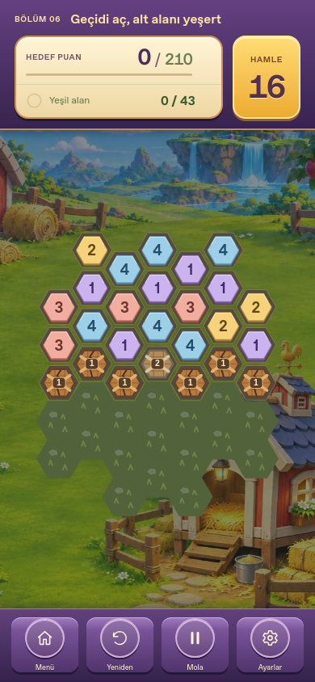
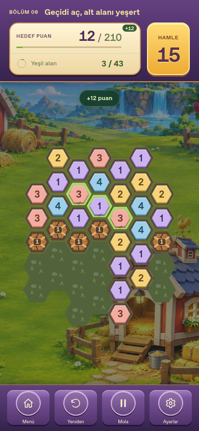
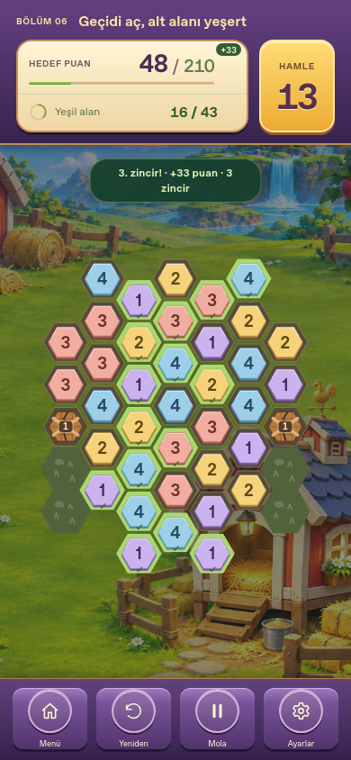
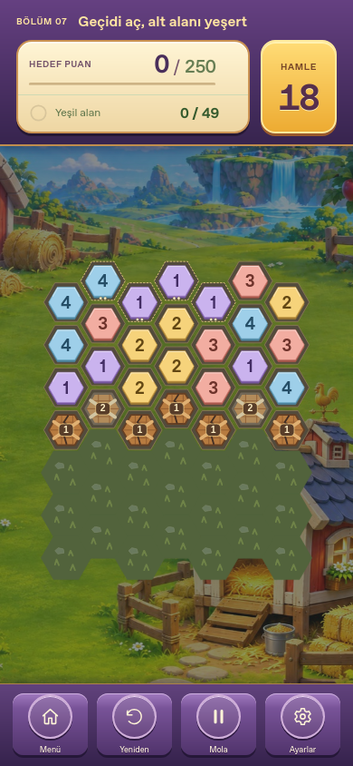
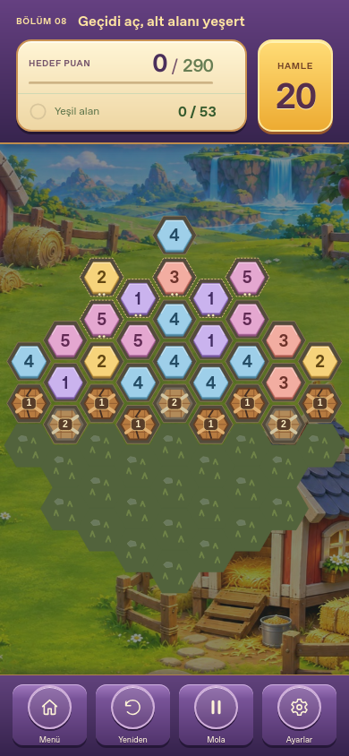
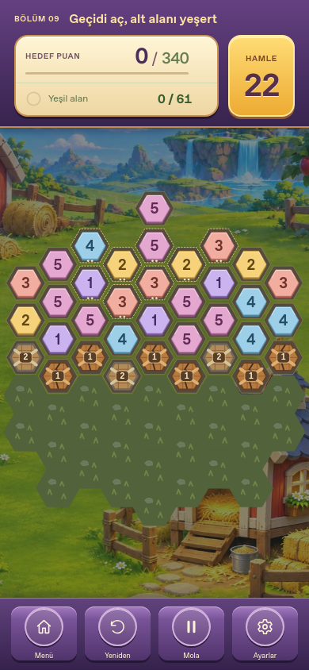
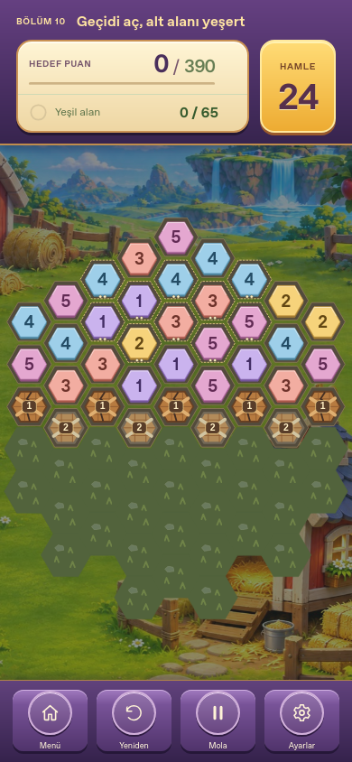

# Hexrota 9.12 — 9×9 çerçevede gerçek altıgen bölüm şekilleri

Güncel geliştirme girişi normal oyunun **`/?dev=flow-9-12`** adresidir. On kampanya bölümü gerçek mevcut menü/haritada seçilebilir. İlk beş bölüm klasik olarak korunur; 6–10 yeni `campaign-flow-v2` tanımlarını kullanır. Main veya Production'a otomatik geçiş yoktur; değişiklik kullanıcı incelemesi öncesinde özellik dalı/draft PR'da kalır.

**9×9, azami yerleşim kapasitesidir.** Her bölüme 81 oynanabilir hücre veya 81 zemin hedefi eklenmez. Bölüm tasarımında bulunmayan koordinatlar gerçek **void** alanıdır. Kutunun arkasında bulunan gerçek kapalı hücreler ise bölümün parçasıdır ve açıldıktan sonra zemin hedefi olarak tamamlanmalıdır.

## Gerçek hücreler ve hedefler

| Bölüm | Ad | Gerçek hücre / yeşil alan hedefi | 81 kapasitedeki void yer | Başlangıç zemin katı toplamı | Hamle | Puan hedefi | İki kazanma yolu |
| --- | --- | ---: | ---: | ---: | ---: | ---: | --- |
| 6 | İnce seçim | 43 | 38 | 43 | 16 | 210 | 8 / 7 hamle |
| 7 | Katman katman | 49 | 32 | 53 | 18 | 250 | 9 / 10 hamle |
| 8 | Uzak köşeler | 53 | 28 | 59 | 20 | 290 | 16 / 16 hamle |
| 9 | Son hamle | 61 | 20 | 69 | 22 | 340 | 18 / 17 hamle |
| 10 | Usta dokunuşu | 65 | 16 | 75 | 24 | 390 | 15 / 13 hamle |

“Yeşil alan” sayacı gerçek hücre sayısını kullanır; iki katlı zemin hücre başına iki eşleşme istediğinden kat toplamı ayrıca daha büyük olabilir. Örneğin 7. bölümün hedefi 49 yeşil hücre ve 53 katı temizlemektir. `total`, `covered`, `remainingLayers`, kazanma, snapshot dizileri ve hit target sayısı 81 çerçeve kapasitesinden türetilmez.

Başlangıçta alt kısımda null taş taşıyan kapalı gerçek hücreler hedef sayısına dahildir. Bunlar void değildir. Void koordinatları `level.cells` içinde yoktur; DOM hücresi, taş, kat, seçim hedefi veya eşleşme hattı oluşturmaz. Void'e dokunma ve void'e doğru sürükleme hamle/RNG tüketmez; düşüş void üzerinden atlayamaz.

## Altıgen geometri ve görünüm

Yeni bölüm verileri `data/campaign-flow-levels-v2.json` içindedir; tarayıcı sarmalayıcısı `dist/campaign-flow-levels-v2.js` / `HEX_CAMPAIGN_FLOW_LEVELS_V2` aynı tanımları taşır. Her bölüm sıralı gerçek axial `q,r` hücrelerinden oluşur. Sunum kapasitesi şu metadata ile bildirilir:

```json
{
  "boardSize": {
    "columns": 9,
    "rows": 9,
    "layout": "odd-q",
    "qMin": -4,
    "rowMin": -4
  },
  "presentation": {"fit":"compact"}
}
```

Yerleşim çerçevesi q `-4…4` ve offset satır `-4…4` aralığındadır. Offset satır hesabı `r + floor(q/2)`'dir. Bu, axial hücreleri ekranda çerçeveye yerleştirme hesabıdır; kareli oyun kuralı değildir. Altı komşu, üç eşleşme ekseni ve q sütunlarına göre düşüş aynı HexMatch kurallarını kullanır.

`HexBoardView.geometry` bütün kapasiteye görsel alan ayırır, yalnız gerçek `level.cells` üyeleri için pozisyon üretir. SVG çizimi de yalnız bu üyeleri dolaşır. Çerçeve sınırlarını hesaplamak için kullanılan köşeler yeni oynanabilir hücre değildir. Renderer genel `boardSize`/`presentation` metadata'sını okur; bölüm kimliği veya 9 sayısı üzerinden özel oyun kuralı çalıştırmaz.

Mevcut sayı taşları, kutular, HUD, uygulama sahnesi ve alt araç çubuğu korunur. Kısa portre ekranlarında mevcut bileşen aralıkları sıkıştırılarak bütün authored altıgenler SVG içinde kalır. Oyun sırasında geometri önbelleği sayısal bölüm ID'sine göre değil, çözümlenen gerçek level nesnesine göre tutulur. Böylece eski 23 hücreli L6 ile yeni 43 hücreli L6 aynı ID altında farklı sürümlerde doğru çizilir.

## Fiziksel kaynak akışı

Bu bölümler mevcut `classic-v5` / `obstacles-v1` çekirdeğinin **`activation:"column-flow-v1"`** sözleşmesini kullanır. Bağımsız bir motor eklenmez. Ortadaki kutu hattı üst taşlar ile kapalı alt araziyi fiziksel olarak ayırır.

Her source kendi q sütununun en üst gerçek hücresidir. Kaynak erişimi aynı q'da yalnız ardışık `r+1` hücrelerinden ilerler. Sağlam kutu veya bulunmayan koordinat yolu keser. Komşu eşleşmeyle kırılan kutu kaldırıldığında yalnız o kaynak yoluna gerçekten bağlanan hücreler `cellOpen` olur. Diğer sağlam kutuların arkasındaki sütunlar kapalı ve null kalır. Bir kutu uzaktaki bütün alt bölgeyi açan anahtar olarak kullanılmaz; çapraz kayma veya void üzerinden ışınlanma yoktur.

Her dalga aynı sırayı korur: eşleşme → kutu başına tek komşuluk hasarı → kırılma → yeni kaynak erişimi → segmentli düşüş → mevcut kontrollü refill → yeni zincir. Puan/hamle yalnız gerçek taş eşleşmesi/takas kurallarından gelir; kutu kırılması ayrı puan veya hamle üretmez. HP 2 aynı dalgada iki kez hasar almaz, ayrı dalgalarda yeniden hasar alabilir.

`regionOpen` yalnız bir grubun tamamen açılmasını topluca raporlar. Kısmi fiziksel açılmada false kalabilir; oynanabilirliği `cellOpen` belirler. Flow bölümlerindeki `regions[].requires` boştur ve `blockers[].regionId` kabul edilmez. Snapshot v5 `blockerHp`, `regionOpen` ve `cellOpen` taşır; her dalgadaki `openedCells` yalnız o dalgada yeni bağlanan gerçek hücreleri bildirir. Aynı history JS ve C# üzerinde aynı HP, taş, zemin, RNG ve sonucu üretmelidir.

RNG sırası ve aynı q düşüşü görsel çerçeve boyutuna bağlı değildir. `boardSize` veya compact yerleşim, eşleşme/topoloji/düşüş/RNG hesabına girmez. Sıkıştırma bütün etkin segmentlerde biter, refill mevcut artan q/r sırasıyla yalnız etkin null hücrelerde çalışır.

## Sürüm arşivi, kayıt ve geri dönüş

Geliştirme profili aynı **`hexrota-flow-9-12:`** önekini kullanır. Normal oyuncu profili ve aynaları okunmaz veya değiştirilmez. Mantıksal SessionStore anahtarları, tek canonical game+energy commit'i, revision/CAS ve writer-lock kuralları devam eder. Serbest bölüm seçimi için sahte tamamlanma, yıldız veya Altın yazılmaz.

Registry bütün tam bölüm tanımlarını sürümleriyle saklar. Varsayılan yeni denemeler her ID için en yüksek tanımlı sürümü seçer; veri dosyalarının yükleme/eklenme sırası sonucu değiştirmez. Güncel 6–10, `flow-v2` / `campaign-flow-v2` kimliğindedir. İlk beş bölüm ve 20 klasik varyantı eski kataloğa delege edilir. Normal URL'nin mevcut 40 varyantı değiştirilmez.

Eski `campaign-flow-v1` L6 checkpoint'i yeni URL'de açıldığında **aynı 23 hücreli tanımı, başlangıç seed'i, hamle bütçesi ve deneme kimliğiyle** devam eder. Restore yeni geometriye göç değildir. Ancak kullanıcı açıkça yeni deneme/restart başlatırsa güncel v2 seçilebilir. Önceki geliştirme akışında 7–10 için oluşmuş klasik v4 varyant/original kayıtları da ilgili eski katalog tanımıyla restore edilir.

İnceleme için yeni deneme varsayılanı açıkça sabitlenebilir:

- `/?dev=flow-9-12`: güncel v2 yeni denemeleri.
- `/?dev=flow-9-12&flowData=campaign-flow-v1`: arşiv v1 L6 varsayılanı; o sürümde override bulunmayan 7–10 klasik kalır.
- `/?dev=flow-9-12&flowData=campaign-flow-v2`: açık v2 varsayılanı.

`flowData` mevcut kayıt kimliğini veya snapshot'ı değiştirmez; arşivleri silmez. Geçersiz sürüm açıkça reddedilir. Kayıt sürümü, variant kimliği, sayısal level ID ve replay sonucu birlikte doğrulanır. V1 taş dizisinin metadata'sını v2 diye yeniden etiketlemek veya başka ID'nin snapshot'ını kullanmak kabul edilmez. `currentLevels` sürüm seçiminin kaynağıdır; geriye uyum için kalan `HexCampaignFlow.version` sabiti “en yeni sürüm” olarak yorumlanmamalıdır.

## Gerçek doğrulama

| Komut/kapsam | Gerçek sonuç |
| --- | --- |
| `check-large-flow-campaign.cjs` | **9 grup geçti**: sıra bağımsız güncel sürüm, 1–5 için 20 klasik varyant, beş v2 prefix, 14 v1 prefix, 20 eski klasik 7–10 restore, pin/kimlik/snapshot retleri ve aynı profil öneki. |
| `check-large-flow-parity.cjs` | Gerçek **.NET 8 / C# 7.3**: 50 mekanik + 103 katalog senaryosu; 10 tam kazanma yolu; 329 takas / 826 dalga; 139 resume, 139 replay, 144 clone, 48 geçersiz kayıt/kimlik reddi; 129 v2 + 14 arşiv v1 checkpoint prefix'i. |
| `check-large-flow-browser.cjs` | **Chromium 9/9 ve gerçek WebKit 9/9** geçti. Normal uygulama, gerçek menü/giriş ve aynı motor kullanıldı; her browser 82 kabul edilen route hamlesi, 12 köşe sürüklemesi ve 17 ekran görüntüsü üretti. |

Browser kapsamı: 320×568, 390×844 ve 430×932'de L6'nın bütün gerçek hücre merkezleri ve tam altıgenleri görünür/hit alınabilir; dört uç hücrede dokunma/sürükleme; gerçek void yanında dokunma/drag reddi; ilk delikten kısmi akış, reload, önceden kapalı alanda hamle ve tam kazanma. 7–10'un her biri 390×844'te gerçek route ile kazanır. Ayrıca bütün on bölüm sahte tamamlanma olmadan seçilir; ilk beş tanım korunur; gerçek v1 hamlesi sonrası v2 URL'sinde aynı 23 hücreli checkpoint devam eder ve yalnız açık restart yeni şekli başlatır.

Her iki browser'daki dokunmalar native touchscreen input'tur. Chromium sürüklemeleri CDP touch input, WebKit sürüklemeleri mevcut native mouse/pointer fallback yoludur. **Fiziksel iPhone testi ve Unity Editor/IL2CPP testi yapılmadı.** WebKit sonucu fiziksel iOS testinin yerine geçmez. Runtime süre ölçümleri test raporunda gözlem olarak bulunur; kabul eşiği veya fiziksel cihaz performansı garantisi değildir.

Bu düzeltmenin bağımsız JS/publication kontrolleri `check-large-flow.cjs` ve sürümlü veri üreticisinin `--check` yolundadır. Tam npm, eski native komutlar ve uzak CI sonuçları ayrı çalıştırılıp raporlanır. Önceki v1 commit'i `2d1dcb1` için [CI 19/19 başarılıdır](https://github.com/kiviman1/hexrota/actions/runs/44092354711); bu sonuç tek başına sonraki v2 kaynaklarının uzak CI sonucu değildir.

## Mevcut uygulamanın ekran görüntüleri

WebKit 390×844, gerçek L6 v2:

| Başlangıç: 43 gerçek hücre | Yalnız bağlı sütunlar açıldı | Yeni alanda oyun devam ediyor |
| --- | --- | --- |
|  |  |  |

Diğer authored şekiller, aynı mevcut uygulama:

| L7 — 49 hücre | L8 — 53 hücre | L9 — 61 hücre | L10 — 65 hücre |
| --- | --- | --- | --- |
|  |  |  |  |

Aynı testlerin Chromium görüntüleri ve L6'nın diğer iki mobil boyutu `reports/flow-9-12-v2/{chromium,webkit}/` altındadır. Görseller mevcut oyunun ekranlarıdır; ayrı tanısal laboratuvar veya ikinci motor değildir.

Kutuların ve örtülü arazinin ilerideki Blender/Unity varlık bağları değişmez: `crate-wood-intact`, `crate-wood-cracked`, `crate-break`, `terrain-covered`. Prefab/animator callback'leri hiçbir koşulda HP, cellOpen, RNG veya kalıcı oyun sonucunun sahibi değildir.


## Son birlikte doğrulama

2026-11-17 UTC tam `npm test` **exit 0**, 13:43:52–13:49:18. Eski zincir korunur; v2 için 14 fiziksel alan grubu ve 9 arşiv/katalog grubu eklidir. C# yeni kapsamı gerçek .NET 8 / C# 7.3 üzerinde 50 mekanik + 103 katalog senaryosu, 329 takas / 826 dalga, 139 restore, 139 replay, 144 clone, 48 sahte kayıt/kimlik reddi ile geçti. On kazanma yolu ve 129 v2 / 14 v1 kayıt kontrol noktası karşılaştırıldı.

Yeni ana oyun browser kabulü Chromium **9/9** ve gerçek WebKit **9/9**, ikisinde de pageErrors `[]`. 320×568 / 390×844 / 430×932, tam hücre sınırları, boş alan girdisi, kısmi akış, yeni alanda oyun ve kazanma doğrulandı; eski v1 kaydıyla doğru geometri ve açık restart ile v2'ye geçiş ayrıca test edildi. Masaüstü emülasyonunda başlangıç medyanı Chromium 464 ms / WebKit 523 ms, hamle commit medyanı 52 / 24 ms olarak kaydedildi; bunlar fiziksel telefon performansı veya kabul eşiği değildir.

Yedi ek regresyon komutu da exit 0: eski v1 browser Chromium/WebKit 6/6; normal integration Chromium 6/6; normal animation Chromium/WebKit 23/23; pinned Lab izolasyonu Chromium/WebKit 6/6. Mevcut 52 authored tahta geometrisi/SVG golden'ları aynen geçer. Klasik motor, orijinal kampanya, 40 varyant, v1 JSON/JS ve klasik audit raporları bu turda byte olarak değiştirilmedi.

`fixtures/board-capacity-protected.json` yalnız listelenmiş 11 view/arşiv/yeni veri kaynağını `2d1dcb1` tabanına bağlar; önceki hash fixture'ları ve davranış golden'ları değişmez. Offline kabuk nesli 51, v1 ve v2 tanımlarını birlikte taşır. Uzak CI sonucu draft PR Checks'ten takip edilir; bitmemiş koşum başarılı ilan edilmez. Birleştirme ve Production geçişi yapılmaz; kullanıcı incelemesinden sonra ayrıca karar verilir.
