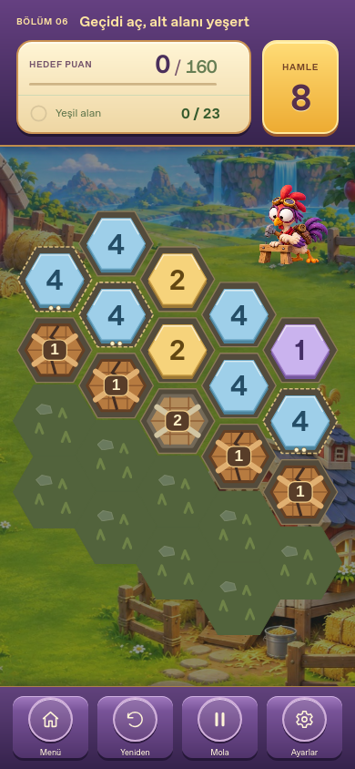
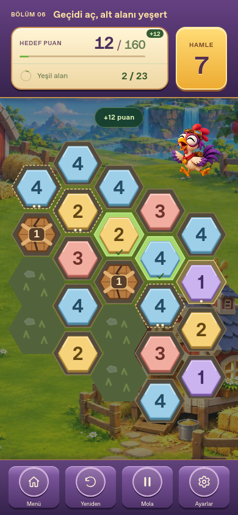
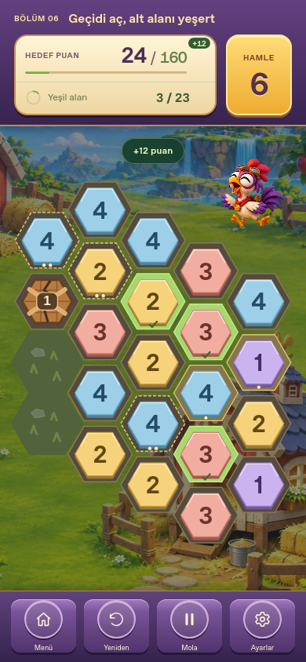
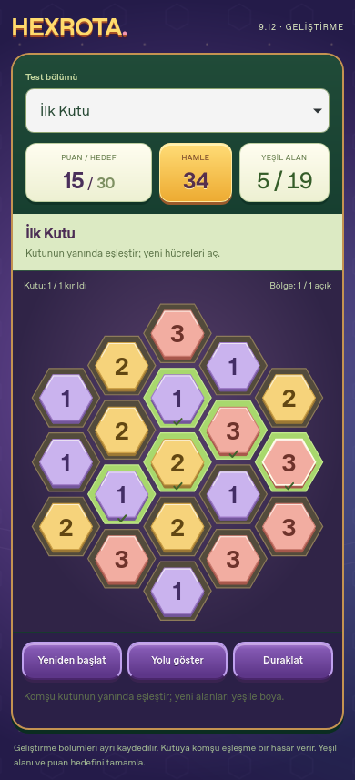
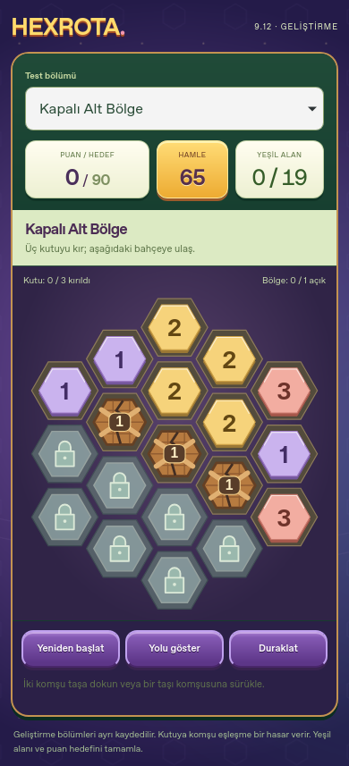

# Hexrota 9.12 — Kırılabilir kutular ve dinamik bölgeler

> **Güncel v2 düzeltmesi:** 6–10. bölümler 9×9 azami çerçeve içinde **43/49/53/61/65 gerçek hücre** kullanır; 81 hedef hücreye zorlanmaz. Normal uygulama girişi, void/kapalı hücre ayrımı, sürümlü kayıt arşivi ve yeni test sonuçları: [LARGE_BOARDS_9_12.md](LARGE_BOARDS_9_12.md). Aşağıdaki 23 hücreli L6 anlatımı arşiv `campaign-flow-v1` sözleşmesidir; mevcut yeni deneme varsayılanı v2'dir.

> **Arşiv v1 kabul akışı — mevcut oyuna entegrasyon:** Son kullanıcı düzeltmesiyle asıl test girişi ayrı laboratuvar değil, normal `index.html` uygulamasının `?dev=flow-9-12` modudur. Bu modda on kampanya bölümü ilerleme doldurmadan seçilebilir; gerçek 6. bölüm aynı arayüz içinde kutu duvarı ve kaynak sütunlarından fiziksel akış kullanır. Aşağıdaki ilk teslim/laboratuvar sözleşmesi geriye uyum ve mekanik kapsamı için korunur. Güncel kaynak akışı ve kayıt ayrımı hemen aşağıdaki **“Mevcut oyundaki 6. bölüm — kaynak sütunu düzeltmesi”** bölümündedir. İlk teslimin CI sayıları sonraki düzeltmenin CI sonucu sayılmaz.

## Mevcut oyundaki 6. bölüm — kaynak sütunu düzeltmesi

Son kabul akışı mevcut normal uygulamadır: `/?dev=flow-9-12`. Ayrı HTML, farklı motor veya yeni bir arayüz düzeni bu akışın yerine geçmez. Menü, bölüm listesi/harita, oyun kartı, sayı taşları, HUD, molalar, sonuçlar ve reload mevcut `app.js` yaşam döngüsünü kullanır. `obstacles.html` önceki AND-geçit mekaniğini incelemek için tanısal bir ekran olarak kalır; bu düzeltmenin ana test adresi değildir.

Geliştirme modu on kampanya bölümünü ilk açılışta seçilebilir yapar. Bunun için öğretici veya kampanya tamamlanmış gibi `done`, `clearedLevelIds`, yıldız ya da Altın üretilmez. Serbest seçim bir geliştirme giriş kuralıdır; gerçek oyun/ekonomi sonuçlarının kanıtı değildir. Normal URL'deki oyuncu ilerleme kilitleri ve eski kayıtlar korunur. Eski `classic-v4` 6. bölüm ve varyantları yeniden yorumlanmaz; yeni 6. bölüm `campaign-flow-v1` verisidir.

### Ayrı geliştirme profili ve katalog

`dist/campaign-flow.js` açık query modunu bulur ve `HexCampaignFlow` üzerinden `enabled`, `prefix`, `storage` ve `createCatalog` verir. Fiziksel kayıt anahtarları **`hexrota-flow-9-12:`** önekiyle ayrılır; örneğin geliştirme profili `hexrota-flow-9-12:hexrota-profile-v2`'dir. Mevcut SessionStore'un mantıksal anahtarları, revision/CAS zarfı ve atomik game+energy commit'i değişmez. Aynalar, eski anahtar aramaları, ses tercihi, olaylar, playtest ve reset temizliği de aynı prefiks adaptöründen geçer. Writer lock `hexrota-flow-9-12:hexrota-profile-writer-v2` olur; normal oyunla aynı yazıcı kilidini paylaşmaz. Üretim anahtarları için Storage.prototype değişikliği veya global yönlendirme yapılmaz.

Yeni mod normal uygulamanın mevcut yolculuk haritasını açar. On kampanya düğümü ve iki öğretici seçilebilir; boş profil `done:[]` olarak kalır. Ekonomi tamamlanma/ödül şartları sahte ilerlemeyle aşılmaz. Mevcut can geliştirme bypass mekanizması yalnız izole profil için kullanılabilir; normal oyuncu canı değiştirilmez.

Dev katalog yalnız sayısal 6 için `flow-v1` / `campaign-flow-v1` kimliğini çözümleyerek mevcut katalog üzerine eklenir. Diğer dokuz bölümün start/restore/resolve işlemleri eski kataloğa delege edilir. Yeni deneme ID'si aynı `a-6-{attemptSerial}-{8hex}` biçimindedir; seçim RNG'si mevcut `HexAttempts.randomStep` kullanır ve oyun RNG'sinden ayrıdır. Katalog kurulurken iki farklı ilk hamleye sahip tam yollar gerçek HexMatch ile kazanma durumuna kadar doğrulanır; ancak sonra yeni deneme başlatılır. Kimlik/snapshot restore'u aynı kanonik motorun strict replay kontrolünü kullanır. Yanlış veri/variant sürümü veya legacy L6 kimliği yeni flow kayıtlarına uygulanamaz.

### L6 verisi ve fiziksel engeller

Kanonik yeni veri `data/campaign-flow-levels-v1.json`, tarayıcı sarmalayıcısı `dist/campaign-flow-levels.js` / `HEX_CAMPAIGN_FLOW_LEVELS` içindedir. Yeni kayıt kimliği sayısal `6`, adı mevcut **İnce seçim**'dir. Orijinal L6'nın **23 axial hücresi, hücre sırası, zemin katları, `[1,2,3,4]` paleti, 160 puan hedefi ve 8 hamle bütçesi** korunur. Başlangıç taşları/seed, kutulu başlangıca uygun yeni sürümlü veridir. İki ayrı açılışla doğrulanmış yolların her biri 7 hamlede kazanır; yollar ve dalga olayları `reports/obstacles-9-12/flow-certificates.json` içindedir.

Tahtanın `r=0` hattında beş kutu vardır. Q sütunları `-2,-1,0,1,2`; kutu hücreleri sırasıyla `[5,8,11,14,17]`'dir. Ortadaki kutu HP 2, diğerleri HP 1'dir. Bunlar seviye verisinin sonucudur; motor bu indeksleri bilmez. Üstteki açık taş alanı ile alttaki örtülü arazi arasındaki duvar bu kutulardan oluşur.

### `column-flow-v1` aktivasyonu

```json
{
  "obstacles": {
    "version": "obstacles-v1",
    "activation": "column-flow-v1",
    "sources": [1,0,2,4,7],
    "blockers": [{"id":"l6-crate-2","cell":11,"hp":2}],
    "regions": [{"id":"l6-lower","cells":[10,13,15,16,18,19,20,21,22],"requires":[]}]
  }
}
```

Bu alanları gösteren şema parçasıdır; tam kutu listesi ve bütün hücreler kanonik bölüm JSON'undan alınır. `activation` olmayan önceki `obstacles-v1` bölümleri AND-geçit kurallarını kullanmayı sürdürür. `column-flow-v1` bu kurallara eklenen açık, sürümlü bir aktivasyon türüdür.

Her source, kendi q sütununun tanımlı en üst hücresidir. Aynı q için iki source, geçersiz koordinat veya sütunun ortasına source yerleştirilmesi reddedilir. Source'dan yalnız **aynı q, r+1** yönünde gerçek bitişik hücrelere ulaşılır. İlk sağlam kutu veya bulunmayan koordinat yolu keser. Çapraz akış, başka sütuna geçiş ve void üzerinden atlama yoktur.

`cellOpen: bool[n]`, bu kaynak yollarından halen erişilebilen hücreleri gösterir. Sağlam kutunun kendi hücresi ve arkasındaki arazi kapalıdır. Komşu gerçek eşleşme kutuyu kırınca HP kesinleşir; kaynak erişimi yeniden hesaplanır; yalnız yeni erişilen hücreler açılır; ardından aynı mevcut q/r düşüşü ve kontrollü refill çalışır. Başka q sütunundaki sağlam kutuların altındaki hücreler kapalı/null kalır. Bir kutunun kırılması bütün alt bölgeyi uzaktan açan bir anahtar değildir.

Flow bölümlerinde `regions[].requires` boş olmak zorundadır; `blockers[].regionId` kullanılmaz ve reddedilir. Region yalnız alanın tamamının açılıp açılmadığını toplu raporlar: `regionOpen[i]`, bu grubun bütün `cellOpen` üyeleri true olduğunda true olur. Arazi **regionOpen=false iken de kısmen açılabilir ve oynanabilir**. Oynanabilirlik için yetkili alan `cellOpen`'dır. Böylece büyük bir region etiketi fiziksel sütun bağlantılarını küresel koşula dönüştürmez.

Flow doğrulaması bütün kutular kaldırıldıktan sonra hedef hücrelerin bir source yolundan erişilebilir olmasını ister; erişilemeyen void sonrası segment veya kaynaksız hedef kabul edilmez. Hasar için yine gerçek altıgen komşuluk kullanılır. Bir sütunun kapalı olması, yan sütundaki oynanabilir komşu eşleşmenin o kutuya hasar vermesini engellemez.

Snapshot v5, flow bölümlerinde zorunlu `cellOpen` dizisini de taşır. Her flow dalgası `cellOpen` ile yalnız o dalgada yeni erişilen sıralı `openedCells` indekslerini verir. `clone`, snapshot/restore ve replay bunları taşır/doğrular; restore aynı history'yi baştan oynatmadan sahte açık hücre kabul etmez. Yeniden çizim, HP veya cellOpen kararını vermez.

### Kısmi açılmanın gerçek kanıtı

İlk sertifikalı açılış `[3,6]` tek eşleşme dalgasında HP'yi `[1,0,1,0,0]` yapar. Yeni açılan hücreler `[8,13,14,17,18,19,21,22]`'dir. Alt alandaki `[10,15,16,20]` hala kapalı/null, toplu `regionOpen[0]` hala false'tur. Q `-2` ve `0` altına taş gelmez; açık üç geçitten oyun devam eder.

İkinci sertifikalı açılış `[6,9]` HP'yi `[0,0,1,1,1]` yapar ve `[5,8,10,13,15,18]` hücrelerini açar. Alt `[16,19,20,21,22]` kapalı kalır. İki farklı ilk tercih gerçekten farklı fiziksel açıklıklar üretir. İki yolun bütün hamleleri gerçek motorla kazanma durumuna kadar yeniden oynatılır; arama bütçesi kazanma kanıtı yerine geçmez.

### Mevcut sunum ve Unity aktarımı

Numaralı taşların mevcut görünümü ve uygulamanın yerleşimi korunur. Flow alt arazisi opak toprak/çimen/taş örtüsü olarak `data-asset="terrain-covered"` kullanır; kilit simgesiyle uzaktan açılan bir kapı gösterilmez. Önceki AND-geçit laboratuvarının `region-closed` varlığı ayrı semantiğini korur. Blender/Unity için yeni `terrain-covered` arazi örtüsü kimliği, açılma sırasında yalnız `openedCells` hücrelerinde kaldırılacak görsel katmana bağlanmalıdır.

Mevcut `HexMovePresentation` ve normal uygulama adaptörleri kutu hasarı/kırılması ile yeni açılan hücreleri gösterir. `REGION_UNLOCK`, flow'da `openedCells` olayını da gösterebilir; toplu region tamamlanmasını beklemez. Taş üretimi kendi gerçek kaynak segmentinin sınırında görsel olarak kırpılır; görsel taş kapalı komşu sütundan geliyor gibi çizilmez. Gerçek sonuç önce mevcut atomik kayıt/commit sınırında kesinleşir. Mola, arka plan, görsel hata veya iptal son kaydedilmiş durumu yeniden çizer.

C# tarafı aynı `HexMatch` partial çekirdeğine `HexMatch.ColumnFlow.cs` ekler. `ObstaclesConfig.activation/sources`, `GameSnapshot.cellOpen` ve `WaveFrame.cellOpen/openedCells` JSON sözleşmesidir; Unity prefab veya fizik callback'i bunları değiştirmez. Unity import adaptörü kanonik yeni bölüm verisini yüklemeli ve metadata'da `campaign-flow-v1` kimliğini korumalıdır.

### Düzeltmenin gerçek ekran görüntüleri

Normal uygulama ve gerçek sayısal 6. bölüm, WebKit 390×844:

| Başlangıç: beş kutu ve örtülü alt arazi | İlk hamle: yalnız bağlı sütunlar açık | Önceden örtülü alanda oyuna devam |
| --- | --- | --- |
|  |  |  |

320×568 ve 430×932 görünümleri ile aynı üç durumun Chromium görüntüleri `reports/flow-9-12/{chromium,webkit}/` içindedir; her browser için dokuz gerçek ekran görüntüsü vardır. Bunlar tanısal A/B/C sayfasının görüntüleri değildir.

### Düzeltmenin doğrulaması

`check-flow-campaign.cjs` gerçek prefix adaptörü, mevcut CAS/reset/writer lock, normal katalog delegasyonu, sertifika ve metadata/forged-checkpoint reddini kapsar. Yerel **exit 0: 10 grup, 36 delege edilen klasik varyant, iki gerçek flow yolunun 14 prefix restore kontrolü**.

Yeni gerçek native koşumlar birbirinden ayrı raporlanır:

| Komut | Gerçek .NET 8 / C# 7.3 sonucu |
| --- | --- |
| `check-obstacles-parity.cjs` — gated + source-flow çekirdek | **217 senaryo**; 716 geçerli takas, 105 resume, 105 replay, 110 clone, 126 checkpoint reddi. Gated altı yol + iki L6 flow yolu ve toplam 48 rota dışı yasal koşu. Typed/portable level okuma, kısmi `openedCells`, HP 2, kalan kapalı sütun, düşüş/refill/RNG ve bozuk source/void/cellOpen girdileri karşılaştırılır. |
| `check-campaign-flow-parity.cjs` — yeni katalog adaptörü | **136 senaryo**; 26 seçim örneği, iki tam kazanma yolu / 14 checkpoint prefix'i ve 85 geçersiz override/kimlik/snapshot reddi. Aynı HexMatch ve CatalogWire kullanılır. |
| Mevcut native gameplay regresyonu | 1.916 geçerli takas ve 80 klasik sertifikalı yol geçti. |
| Mevcut native catalog regresyonu | 2.107 JSON karşılaştırması geçti. |

Bu sayılar farklı gözlem türleridir; tek hayali test toplamına eklenmez. C# karşılaştırması Unity Editor veya fiziksel iPhone testi değildir.

Yerel son yeni flow JS koşumu **16/16 grup** geçti. Yeni normal uygulama browser koşumu **Chromium 6/6 ve WebKit 6/6**, iki browser'da page-error dizileri boş: boş geliştirme profilinden bütün on gerçek bölüm seçimi; üç mobil boyutta kaynak sütunlarının kısmi açılması, ilk hamlede native sürükleme, sonraki gerçek dokunma hamleleriyle 7 hamlede kazanma, önceden kapalı alanda takas ve birebir reload; normal sunum aşamalarında tek önceden kesinleşmiş canonical yazı doğrulandı.

`check-column-flow.cjs`, source doğrulaması, gerçek void aralığı, kutuların fiziksel kesmesi, farklı kısmi açılışlar, aynı q düşüşü, açılan alandaki doğal zincir, bozuk `cellOpen`, snapshot/replay/clone ve iki tam kazanma yolunu denetler. `check-flow-browser.cjs`, ayrı lab yerine gerçek normal uygulamayı açar; üç mobil viewport'ta gerçek dokunma/sürükleme, boş geliştirme profilinden serbest bölüm seçimi, örtülü hücre etkileşimsizliği, kısmi açılma, devam ve reload sonuçlarını doğrular. Gerçek koşum sayıları tamamlandığında bu düzeltme için ayrıca yazılır; yukarıdaki ilk teslim sayıları otomatik olarak bu değişikliklerin sonucu sayılmaz.


---

### Güncel birlikte doğrulama sonucu

2026-11-17 UTC son tam `npm test` **exit 0**: 13:17:16–13:22:33. Mevcut zincir korunur; ek `test:column-flow` içinde 16 fiziksel akış ve 10 kampanya adaptörü grubu bulunur. Son v5 kayıp paneli koşulu düzeltildikten sonra klasik ikinci şans UI'sı ayrıca 15 grup / 169 gerçek takas / 22 kayıp / 4 reload ile; rescue-safety UI 8 grup ve actual-app animation 11 grup ile tekrar geçti. Yeni browser kontrolünün altıncı grubu gerçek sekiz hamlelik kayıp, checkpoint reload, yeni deneme ve native Retry'ı doğrular; Chromium ve WebKit 6/6, pageErrors `[]`.

Güncel kaynakla mevcut integration Chromium 6/6; animation Chromium 23/23 ve WebKit 23/23; sabit Lab izolasyonu iki browser'da 6/6 geçti. Mevcut on native parity komutu da geçti; yeni fiziksel çekirdek ve kampanya adapter'ı gerçek .NET 8 / C# 7.3 ile ayrıca karşılaştırıldı.

Klasik observable ve solvability raporları yeniden üretildi: main'e göre sadece üç kaynak parmak izi alanı değişir; bütün sertifika, karar, metrik ve solver sonuçları birebir aynıdır. Eski hash fixture'ları/golden'lar değiştirilmez. `fixtures/flow-integration-protected.json` bu düzeltmenin 21 açıkça listelenmiş kaynak dosyasını `a93c920` tabanına bağlar; eski kaynak korumaları bunun dışındaki dosyalarda aynı kalır. Stil manifestinin önceki sırası korunup yalnız `10-obstacle-flow.css` sona eklenir. Offline kabuk nesli 50, yeni kampanya modüllerini de önceden yükler.

Bu düzeltme normal app içinde geliştirici query'siyle denendi; fiziksel iPhone veya Unity Editor/IL2CPP testi yapılmadı. Main ve Production'a yazılmaz. Uzak CI durumu draft PR Checks'ten izlenir; bu yerel sonuçlar bitmemiş uzak koşumu başarılı ilan etmez.

## Önceki tanısal teslim — geriye uyum kaydı

Aşağıdaki A/B/C laboratuvarı ve AND-geçit sözleşmesi, önceki tanısal uygulamanın belgesidir. Güncel kullanıcının istediği fiziksel L6 akışı ve asıl oynanabilir teslim yukarıdaki normal uygulama bölümüdür. Buradaki eski test/CI sayıları yeni düzeltmenin sonucunu temsil etmez.

## İlk tanısal teslimin kapsamı ve uyumluluğu

Bu özellik mevcut `dist/engine.js` / `unity/Gameplay/HexMatch.cs` motorlarını genişletir. Yeni bir demo motoru veya ikinci kalıcı oyun durumu yoktur. Yeni bölüm kuralları `classic-v5`, engel veri sözleşmesi `obstacles-v1`, motor checkpoint'i **snapshot v5** kullanır. Kampanya, öğreticiler, 40 varyant ve 80 sertifikalı yol `classic-v4` / snapshot v4 olarak kalır. Eski kayıtlar v5'e dönüştürülmez.

Çalışmanın tabanı main `a3b5640`'tır; özellik dalı `feature/hexrota-blockers-regions-9-12`'dir. PR #34 ve #35'teki ayrı Unity hazırlık çalışmaları bu uygulamanın kaynağı değildir. Main veya Production'a otomatik yayın yapılmaz.

Snapshot v5, mevcut profil anahtarı `hexrota-match-v5` ile aynı şey değildir. İlki bu yeni motorun checkpoint sürümüdür; ikincisi mevcut kampanyanın tarihsel kayıt anahtarıdır. Geliştirme ekranı kampanya profilini, canı, ekonomiyi veya attempt seçim RNG'sini kullanmaz.

## Dosyalar ve sorumluluklar

| Dosya | Sorumluluk |
| --- | --- |
| `dist/engine.js` | Aynı HexMatch içinde sürüme göre hasar, bölge açma, etkin geometri, düşüş, RNG ve replay |
| `unity/Gameplay/HexMatch.cs`, `HexMatch.Obstacles.cs` | Aynı C# partial HexMatch çekirdeği; UnityEngine bağımlılığı yok |
| `unity/Gameplay/GameplayTypes.cs` | Engel, bölge, hit, checkpoint ve dalga DTO'ları |
| `unity/Gameplay/BoardTopology.cs` | Değişmez axial komşular, üç eksen, q sütunları ve üçlüler |
| `data/obstacle-levels-v1.json` | Unity'ye de aktarılabilir kanonik geliştirme bölümleri ve doğrulanmış yollar |
| `dist/obstacle-levels.js` | Aynı verinin tarayıcı sarmalayıcısı; `HEX_OBSTACLE_LEVELS` |
| `scripts/generate-obstacle-levels.cjs` | Gerçek motorla çevrimdışı bölüm/yol üretimi; oynarken çalışmaz |
| `dist/obstacles.html`, `obstacle-lab.js`, `obstacle-lab.css` | Ayrı geliştirme ekranı, host kayıt/işlem sınırı ve geçici görseller |
| `dist/board-view.js` | Mevcut saf SVG projeksiyonu ve taş kimliği koruyan reconcile adaptörü |
| `dist/move-presentation.js` | Kesinleşmiş motor dalgalarının kopyalanmış/dondurulmuş görsel sırası |
| `dist/board-input.js` | Ortak altıgen dokunma/sürükleme sınıflaması |

`attempts.js` kampanya varyant paketlerini ve ayrı seçim RNG'sini yönetmeye devam eder. Yeni geliştirme bölümleri bu kataloğa eklenmez. `idle-hints.js` motor veya kayıt sahibi değildir; mevcut kampanyanın bekleme ipucu sözleşmesi değişmez. Yeni engellerin bulunduğu tahtanın yetkili uygunluk kontrolü `isPlayable` / `IsPlayable`'dır.

## Bölüm verisi

Şema parçası aşağıdadır. `cell` ve `cells` değerleri aynı level içindeki sıralı hücre dizisinin indeksidir; hücreler yalnız axial `q,r` ile tanımlanır. Oyun koduna bölümün hücre numaraları gömülmez.

```json
{
  "rulesVersion": "classic-v5",
  "levelDataVersion": "obstacles-v1",
  "cells": [{"q":0,"r":0,"layers":1}],
  "initial": [null],
  "palette": [1,2,3],
  "seed": 123,
  "moves": 35,
  "target": 30,
  "obstacles": {
    "version": "obstacles-v1",
    "blockers": [
      {"id":"gate-a","cell":0,"hp":2,"regionId":"garden-a"}
    ],
    "regions": [
      {"id":"garden-a","cells":[1,2],"requires":["gate-a"]}
    ]
  }
}
```

Bu parça alan adlarını gösterir; kendi başına tam ve geçerli bir bölüm değildir. Tam oynanabilir örnekler kanonik JSON içindedir.

- `blockers[].hp` başlangıç dayanıklılığıdır: yalnız 1 veya 2. Güncel HP çalışma durumundaki `blockerHp[]` dizisindedir; dizi sırası tanım sırasıyla aynıdır. HP 0, kırılmış kutunun kalıcı kaydıdır; tanımı silinmez.
- `blockers[].regionId` isteğe bağlı bir bağdır. Varsa adlandırılan bölgenin `requires` listesi kutuyu içermelidir. Bir kutu birden fazla bölgenin koşulunda bulunabilir; yetkili ilişki her bölgenin `requires` listesidir.
- `regions[].requires`, bütün üyeleri kırılmadan açılmayan **AND** koşuludur. Boş veya yinelenen koşul, bilinmeyen kutu ve imkânsız döngü reddedilir.
- `regions[].cells` başlangıçta kapalıdır. `regionOpen[]` tanım sırasıyla `false` başlar, yalnız koşul tamamlandığında `true` olur. Açılma geri alınmaz.
- Kutular ve bölgeler varsayılan olarak kazanma için zorunludur. `required:false` açık istisnadır; zemin ve puan hedeflerini kaldırmaz.
- Aynı hücrede iki kutu, çakışan iki bölge veya bir bölgenin kendi içinde yinelenen hücre reddedilir. Bir kutu kapalı bölgenin içinde bulunabilir; önce o bölge açılmalı, sonra kutu hasar alabilir. Çok aşamalı C bölümü bu ilişkiyi kullanır.
- Tanımlı ama kapalı hücre ile **void** farklıdır. Void koordinatı `cells` içinde hiç yoktur: taş, zemin, komşuluk geçişi veya hedef sayısı oluşturmaz.
- V5'te `layers:0` gerçekten sıfır zemindir; eksik/null kat 1'dir. V4'ün tarihsel eksik/null/0 → 1 davranışı korunur.
- Başlangıç `null` yalnız kutulu veya kapalı hücrelerde geçerlidir. Başlangıçtaki bütün açık hücreler paletten bir tamsayı taş taşır.

Kimlikler 1–80 karakterlik `A–Z`, `a–z`, `0–9`, `_`, `.`, `-` dizgeleridir. Koordinatlar ve taş değerleri signed Int32, hamle/kat/hedef negatif olmayan Int32, seed unsigned 32 bit aralığını kullanır. C# komşuluk ara hesapları taşmadan yapılır. Palet sırası ve yinelenen değerlerin ağırlığı korunur.

Yapısal doğrulama, başlangıçtaki açık hücrelere komşu kutuları varsayımsal olarak kaldırarak ve koşulu tamamlanan bölgeleri açarak bütün kutuların topolojik olarak erişilebilir olmasını denetler. Bu, eşleşme veya kazanılabilirlik kanıtı değildir. Yayın kabulü, gerçek motorla tam kazanma yolunun yeniden oynatılmasını ayrıca gerektirir. Arama bütçesinin bitmesi çözümsüzlük kanıtı değildir.

## Bir hamlenin kuralları

Takas önce sonuç durumu, axial komşuluk ve iki hücrenin oynanabilirliğiyle doğrulanır. Kutu ve kapalı hücre seçim/takas hedefi olamaz. Eşleşme üretmeyen takas taşları geri koyar; hamle, geçmiş, puan ve RNG değişmez.

Geçerli takas bir hamle tüketir ve yalnız bir history çifti ekler. Her eşleşme dalgasında:

1. Üç axial eksendeki eşleşmeler belirlenir. Kapalı/kutulu hücreler eşleşmeye katılmaz.
2. Eşleşen taş değerleri kadar mevcut puan eklenir ve ilgili zemin katı bir azaltılır.
3. Eşleşen hücrelere altıgen komşu olan, kendi bölgesi açık her sağlam kutu **bir** hasar alır. Aynı dalgadaki birden fazla temas veya kesişen eşleşme ikinci hasar vermez.
4. HP 0 kutular kaldırılmış kabul edilir. Ayrı bir puan veya hamle kazanımı oluşmaz.
5. Bütün koşul kutuları HP 0 olan bölgeler açılır.
6. Yeni etkin geometriyle düşüş ve kontrollü refill çözülür.
7. Yeni eşleşme varsa aynı hamlenin sonraki dalgasına geçilir. Aynı kutu sonraki dalgada yeniden hasar alabilir.
8. Dalga sınırı, hamlesiz tahta kurtarma ve son durum mevcut motor sırasıyla tamamlanır; host sonucu kaydeder.

Yeni açılmış bölgenin içindeki kutu, o dalganın hasar aşaması tamamlandıktan sonra görünür olduğundan ancak sonraki dalgada hasar alır. Animasyon sonucu veya süresi hiçbir aşamada HP, RNG veya geometri kararı vermez.

Kazanma mevcut puan (`at least` veya exact) ve bütün tanımlı hücrelerin zeminini bitirme şartlarına ek olarak zorunlu kutuların kırılmasını ve zorunlu bölgelerin açılmasını ister. Son hamlede tamamlanan hedef kazanır. Kalan hamlenin sıfır olması veya exact hedefin aşılması mevcut kayıp kuralıdır. Sonuç checkpoint alanı olarak güvenilmez; kaydedilmiş gerçek durumdan yeniden türetilir.

## Segmentli düşüş ve deterministik RNG

V4'ün q sütunlarına göre tarihsel düşüş/refill çıktıları korunur. V5 her q sütununu artan r sırasıyla tarar ve oynanabilir, r farkı tam 1 olan ardışık hücrelerden segmentler oluşturur. Sağlam kutu, kapalı bölge veya bulunmayan koordinat segmenti keser. Çapraz kayma yoktur.

Her segmentte eşleşmeyen dolu taşların sırası korunur ve artan r yönündeki alt boşluklara sıkıştırılır. Kutunun kırılması veya bölgenin açılmasıyla oluşan yeni null hücreler de gerçek boşluktur; survivor sayılmaz. Yalnız artık gerçekten bitişik olan segmentler birleşebilir. Taş kapalı hücreyi, kutuyu veya void boşluğunu aşamaz.

Bütün segmentlerin sıkıştırılması **refill başlamadan** biter. Refill, mevcut q artan / r artan sırasını korur ve yalnız oynanabilir null hücrelere taş üretir. Her hücre için üçlüler üzerinden olası yeni eşleşme sayısı hesaplanır; en düşük sayılı palette seçeneklerinden mevcut XorShift32 ile seçilir. Her doldurulan hücre bir RNG çekimi tüketir. HP hasarı, bölge açılması, asset seçimi ve animasyon RNG tüketmez.

`falls` gerçek kaynak/hedef taş kimliğini ve spawn sırasını taşır; eşit değerler farklı taşların hareketini saklamaz. `compacted` refill öncesi gerçek ara dizidir. Bu metadata sunum içindir; görsel arıza son tahta dizisini değiştiremez.

Hamlesiz tahtanın kurtarılması yalnız açık taşları karıştırır veya üretir. Kapalı hücrelerin null durumu, HP, bölgeler, zemin, puan ve geçmiş korunur. Sınırlı arama başarısız olursa yardımcı taşları ve RNG'yi giriş durumuna geri alır ve açık hata verir. Her şekil için yasal hamle bulunacağı iddia edilmez; host başarısız hamleyi kalıcılaştırmaz.

## Snapshot v5 ve replay

```text
version: 5
rulesVersion: classic-v5
obstacleVersion: obstacles-v1
values: (int | null)[]
layers: int[]
blockerHp: int[]
regionOpen: bool[]
score: int
movesLeft: int
turn: int
rngState: uint32
history: [[a,b], ...]
```

Blocker/bölge dizileri aynı sürümlü level tanımlarının sırasına bağlıdır. Kırılmış kutu `blockerHp[i] === 0` ile, kapalı bölge `regionOpen[i] === false` ile saklanır. Bölüm tanımı veya sırası değişecekse yeni veri sürümü gerekir; eski checkpoint sessizce yeni tanımla okunamaz.

Restore yalnız şekil kontrolü yapmaz: aynı bölüm başlangıcından bütün history takaslarını yeni bir HexMatch üzerinde yeniden oynatır ve her kanonik alanın eşitliğini ister. Sahte HP, erken açılmış bölge, değiştirilmiş RNG/zemin/puan/taş, eksik alan ve geçersiz geçmiş reddedilir. Yerleşmiş aktif hücrede null kabul edilmez; kapalı/kutulu hücrede taş kabul edilmez. Geçici null yalnız motorun düşüş/refill ara projeksiyonlarında bulunabilir. `clone` HP ve bölge dizileri dahil bütün değişebilir durum dizilerini kopyalar; kaynak oyun değiştirilmez.

C# host JSON adaptörü nullable taş ve `falls.from:null` alanını korumalıdır. Eski v4 wire çıktısına yeni obstacle alanları `null` olarak eklenmez. Core DTO'ları saf C#'tır; platform serializer ayarı gameplay kuralı değildir. `JsonUtility` tek başına genel iç içe/nullable sözleşmenin tam yükleyicisi sayılmaz.

## Web geliştirme ekranı ve sunum

Doğrudan `/obstacles.html` açılır. Test A/B/C seçimi, dokunarak veya sürükleyerek takas, HP, bölge durumu, puan/hedef, kalan hamle, yeşil alan, restart, duraklatma, sonuç ve reload ile devam bu host'tadır. Geliştirme kaydı yalnız `hexrota-obstacles-lab-v1` anahtarını kullanır. Zarf `{version:1, levelDataVersion:'obstacles-v1', activeId, boards:{id:snapshot}}` biçimindedir. Kampanya/profil anahtarlarını okumaz veya değiştirmez. Sayfa mevcut tema CSS'ini, gerçek engine'i, board-view/reconcile, board-input ve move-presentation bileşenlerini kullanır.

Sunum sırası gerektiğinde `SWAP → MATCH → BLOCKER_HIT → BLOCKER_BREAK → REGION_UNLOCK → CLEAR → FALL → REFILL → CASCADE → SETTLE` olur; boş aşamalar atlanır. Klasik `PHASES` dışa aktarımı korunur; obstacle fazları ayrı `OBSTACLE_PHASES` kataloğundadır.

Host önce gerçek hamleyi çözer ve snapshot'ı kaydeder, sonra salt-okuma görsel planı oynatır. Gösterim sırasında giriş kilitlidir. Görsel hata, duraklatma, pagehide veya görünürlük kaybı gösterimi iptal eder; son kesinleşmiş gerçek checkpoint yeniden çizilir. Görsel callback ikinci kayıt, hasar veya ödül üretmez. Kayıt yazımı başarısız olursa host eski gerçek durumu korur ve hata gösterir.

## Önceki tanısal A/B/C bölümleri

| Bölüm | Geometri ve öğretim amacı |
| --- | --- |
| A — İlk Kutu | 19 hücreli küçük axial altıgen; bir HP 1 kutu; komşu eşleşme ile kutunun kırılması, bağlı hücrelerin açılması ve refill; iki yol 5 ve 4 hamle |
| B — Kapalı Alt Bölge | 19 hücreli altıgen; üç HP 1 orta engel; hepsi kırılmadan kapalı kalan alt bölge ve açıldıktan sonra devam; iki yol 5 ve 5 hamle |
| C — Çok Aşamalı Açılma | 37 hücreli altıgen; HP 1 ve HP 2 kutular, iki bağımsız bölge koşulu; ilk bölgenin içindeki güçlendirilmiş kutu ikinci bölgeyi açar; iki yol 4 ve 4 hamle |

Her bölümün `solutions` dizisi gerçek motorla yeniden oynatılan kazanma yollarını taşır. `solution`, ilk yolun uyumluluk kopyasıdır. Bölüm üreticisi runtime'da çalışmaz; başlangıç veya hedef oyuncunun kararına göre değiştirilmez. Yol sertifikaları ve gerçek test sayıları aşağıdaki doğrulama kaydına eklenir.

## Blender / Unity görsel bağlama sözleşmesi

Geçici ahşap görseller uygulama içinde çizilmiş özgün SVG şekilleri, çizgiler, HP rozeti ve parçacıklardır. Üçüncü taraf oyun varlığı kullanılmaz. Sonraki Blender varlıkları yalnız sunum katmanına aşağıdaki kararlı anlamlarla bağlanmalıdır:

| Görsel/asset kimliği | Kaynak motor olayı veya durumu | Unity sunum karşılığı |
| --- | --- | --- |
| `crate-wood-intact` | HP 2 kutu | Sağlam ahşap prefab/mesh |
| `crate-wood-cracked` | HP 1 kutu | Çatlamış prefab veya material varyantı |
| `crate-break` | `brokenBlockers` olayı | Ömrü sınırlı parça/particle prefab'ı |
| `region-closed` | `regionOpen[i] === false` | Etkileşimsiz kaplama görseli |
| `region-unlock` | `openedRegions` olayı | Ayrı Unity effect kimliği için ayrılmıştır; web mevcut `region-closed` kaplamasını soldurarak kaldırır |

Web SVG düğümleri `data-asset` üzerinden ilk dört kimliği taşır. `region-unlock` şu anda ayrı bir SVG asset değildir.

HP 1 başlangıç kutusu ve HP 2'den hasar almış kutu aynı HP 1 çatlak görünümünü kullanabilir. Prefab adı oyun kuralı değildir. Physics, collider veya animator callback'i hasar, RNG, kazanma ya da kayıt yazamaz. Unity presenter WaveFrame verisini okuyup kendi nesnelerini günceller; gelecekteki board input adaptörü de `IsPlayable` kontrolünü kullanır. Görsel nesne yüklenemezse oyun ilerlemesi korunur.

## Doğrulama komutları ve kapsam

- `node check-obstacles.cjs`: yeni mekaniğin JS kuralları, veri/snapshot retleri, yollar, clone/replay ve kurtarma kontrolleri.
- `node check-obstacles-parity.cjs`: gerçek .NET 8 üzerinde C# 7.3 derlemesi; yeni motor durumları ve dalga çıktılarının JS ile karşılaştırılması. JS fallback başarı sayılmaz.
- `node check-obstacles-browser.cjs`: gerçek browser'da 320×568, 390×844 ve 430×932; gerçek giriş, reload, gösterim iptali ve geliştirme kaydı izolasyonu.
- `npm test`: mevcut test zinciri ve eklenen engel kontrolleri. Eski goldens, varyant yolları ve kabul eşikleri korunur.
- `npm run test:unity-gameplay`: arşiv klasik mekanik vektörleri, 40 varyantın 80 yolu ve eski restore/recovery karşılaştırmaları.

Bu belge uygulama sözleşmesini tarif eder. Koşum sonuçları, komutların gerçek çıkışları ve sayılarıyla aşağıya eklenmelidir; testin yazılmış olması testin geçtiği anlamına gelmez. Yapısal kabul, yasal hamle ve kazanma ayrı iddialardır.

## Önceki tanısal teslimin doğrulama kaydı ve sınırları

2026-11-17 UTC yerel `node check-obstacles.cjs` **exit 0**: 26 grup, 3 bölüm, farklı ilk hamlelerden başlayan 6 tam kazanma yolu ve 27 replay/restore/clone prefix kontrolü. Bu sayılar yalnız bu JS komutunun çıktısıdır; diğer koşumların yerine geçmez.

Yeni engel parity komutu gerçek .NET 8 / C# 7.3 derlemesiyle **exit 0**: 141 senaryo; 6 sertifikalı yol ve 36 rota dışı yasal koşu; 592 geçerli takas, 65 resume, 65 replay, 66 clone ve 86 checkpoint reddi. Hasar/açılma, bütün düşüş/refill dalgaları, RNG ve sonuç JSON'ları JS ile karşılaştırıldı. Eski dokuz C# parity komutu ve ayrıca mevcut gameplay parity komutu da geçti; bunlar yeni test sayılarıyla tek bir toplamda birleştirilmez.

Mevcut kampanyanın gerçek browser regresyonu da **exit 0**: `check-integration-browser.cjs` Chromium 6/6 grup, boş page-error ve dış istek dizileri; `check-animation-pipeline-browser.cjs` **Chromium 23/23 ve WebKit 23/23** grup, iki motorda da boş page-error dizisi. WebKit koşumunda eksik sistem kitaplıklarının yerel Playwright dizinine kurulmasından sonra gerçek WebKit çalıştırıldı; `PLAYWRIGHT_SKIP_VALIDATE_HOST_REQUIREMENTS=1` yalnız ön koşul denetimini atlar, browser veya assertion yedeği kullanmaz. İkinci test altı viewport, gerçek çok dalgalı düşüş/taş kimlikleri, tek canonical yazı, hata/iptal, geç callback ve reload durumlarını kapsar. Integration testi CDP kullanır ve Chromium'a özgüdür; WebKit'te çalışmış gibi sayılmaz.

Bu geliştirme sırasında fiziksel iPhone testi veya Unity Editor/IL2CPP sahne testi yapılmış değildir. Browser viewport ve WebKit testi fiziksel iOS testi olarak sunulmaz. Unity Cloud kurulumu, hesap yetkilendirmesi veya yerel Blender dosyası istenmez. C# parity saf gameplay kuralları içindir; gelecekteki prefab görünümü veya native dokunma sürücüsünün testi değildir.


## Önceki tanısal A/B/C ekran görüntüleri

Gerçek WebKit koşumunda 390×844 görünümü; her bölümün başlangıç ve ilk açılma durumu:

| Bölüm | Başlangıç | Açıldıktan sonra |
|---|---|---|
| A — İlk Kutu |  |  |
| B — Kapalı Alt Bölge |  |  |
| C — Çok Aşamalı Açılma |  |  |

Kaynak koruma: önceki hash fixture'ları ve davranış golden'ları değiştirilmez. `fixtures/obstacles-regions-protected.json` yalnız belirtilen on çekirdek/sunum/native host dosyasının yeni tam SHA-256 değerlerini main `a3b5640` tabanına bağlar. Eski koruma testleri bu dar overlay'i okur; katalog verileri, command sonuç goldeni ve eşikler aynıdır. Offline shell 48→49 ile güncellenir; `app.js`, `hint-worker.js`, ana HTML ve UI kit farkları yalnız cache query'sidir.


### Birlikte doğrulama kanıtı

| Gerçek koşum | Sonuç |
|---|---|
| `test:obstacles` | 26 JS grubu; 6 kazanma yolu, 27 replay/restore/clone prefix; dokuz sunum sınırında iptal |
| `test:unity-obstacles` | 141 native senaryo; 592 takas, 65 resume, 65 replay, 66 clone, 86 bozuk snapshot denemesi; 36 rota dışı koşu |
| `test:unity-gameplay` | 71 eski mekanik + 4 recovery + 80 tam sertifika + 120 rota dışı koşu; 1.916 geçerli takas, 258 resume, 262 replay, 2.177 clone kontrolü, 1.050 ret; ek 74 yapı girdisi ve 17 recovery karşılaştırması |
| Diğer mevcut C# komutları | rewards, catalog, hints, reward-adapter, lives, economy, commands, rescue ve session: 9/9 komut exit 0; gerçek .NET **8.0.428**, C# **7.3** |
| Yeni mobil browser | Chromium **14/14**, WebKit **14/14**; her iki motorda üç bölüm × üç boyut, gerçek tap/drag, reload, kazanma, iptal/arka plan, animasyon ve ilk çizim hatası, bozuk kayıt; pageErrors `[]` |
| Mevcut kampanya browser | Chromium integration/offline **6/6**; Chromium animation **23/23**; WebKit animation **23/23**; pageErrors `[]` |
| Mevcut pinned Balance Lab izolasyonu | Chromium **6 grup**, WebKit **6 grup**; her birinde 68 değişmez dosya ve 10 korunan kayıt anahtarı. Eski fixture yalnız ayrı detached test worktree'sinde okunur. |

İlk tam npm denemesinde, paralel audit yükü altında mevcut reduced-motion testinin 180 ms duvar saati assertion'ı başarısız oldu. Değişmemiş score testi ayrı koşumda geçti; eşik veya assertion değiştirilmedi. Son tam `npm test` **exit 0**, 12:42:01–12:46:53 UTC (yaklaşık 292 saniye). Mevcut zincirin tamamı ve yeni 26 JS grubu birlikte geçti.

Klasik observable ve solvability raporları gerçek araçlarla yeniden üretildi. Main ile tam JSON karşılaştırmasında yalnız `observable.sourceHash`, `solvability.sourceHash` ve `solvability.historicalObservableReference.sourceHash` farklıdır; bütün sertifikalar, kararlar, metrikler ve solver sonuçları aynıdır. Yeni hash'ler ek 9.12 fixture'ında sabitlenir; eski fixture'lar değiştirilmez.

Canlı Preview `142bc39` runtime'ında 390×844 Chromium ile ilk A takası gerçek dokunma üzerinden yürütüldü: HP `[0]`, bölge `[true]`, turn `1`; reload snapshot'ı birebir aynı, pageErrors `[]`. Bu Preview feature dalıdır; Production değildir. Süreli paylaşım anahtarı kaynak koda veya bu belgeye yazılmaz.

Ek checkpoint kontrolü gerçek takasla HP 2→1 kalan kutuyu kaydedip geri yükler ve sonraki hamleyi karşılaştırır; ayrıca bir hamlelik gerçek kayıp geçmişini restore/replay/clone ile doğrular. Bu iki native akış son 141 senaryoya dahildir.


Son kaynak değişikliklerinden sonra `git diff --check`, PWA, architecture ve dar hash korumaları da geçti. Main ve Production'a yazılmadı; PR #34/#35 taşınmadı veya birleştirilmedi. Yerel test sonuçları uzak CI tamamlanmış gibi sunulmaz; uzak durum draft PR Checks ekranından izlenir.
