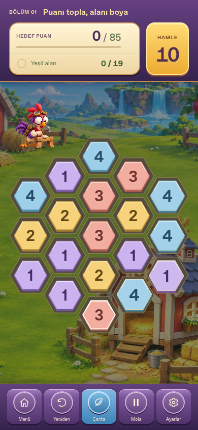
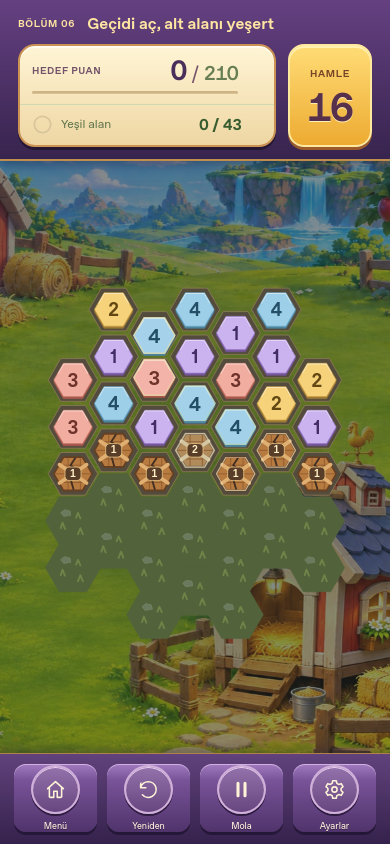
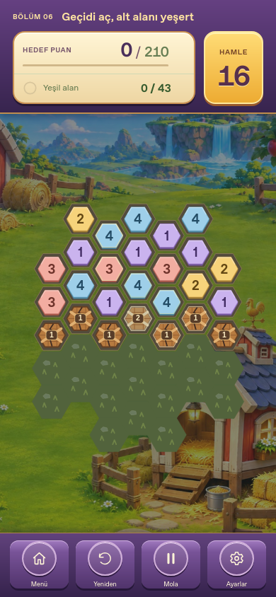

# Hexrota 9.10 — pasif bekleme ipuçları

> **Güncel 9.12 uyumluluk düzeltmesi:** Aynı pasif sistem `classic-v4` yanında kutulu/kapalı hücreli `classic-v5` tahtalarında da çalışır. Üretim zamanlaması artık 900 ms görünüm + 900 ms sessizliktir; ilk üç başlangıç 10.000 / 11.800 / 13.600 ms olur. Aynı görünür ilk eşleşmenin taş kaynakları ve hasar alacak kutular geçici olarak vurgulanır. Yeni gameplay komutu, kayıt veya kazanma garantisi eklenmez. Aşağıdaki sözleşme bu güncel davranışı tarif eder.

Bu değişiklik, kampanya tahtasında uzun süre giriş olmadığında kısa bir komşu taş önerisi gösterir. Oyuncu giriş yapmadan aynı uygun tahtada beklemeye devam ederse aynı çift, gösterimler arasında 900 ms sessiz kalarak yeniden belirir. Üretim arayüzündeki manuel ipucu düğmesi ve **H** ipucu kısayolu kaldırılmıştır. Öğreticilerin mevcut yönlendirmesi korunur. Öneri, görünen ilk eşleşmenin yararını değerlendirir; kazanma rotası veya kazanma garantisi vermez.

Geliştirme tabanı `616c663`, dal `feature/hexrota-smart-idle-hints-9-10`'dur. Mevcut 9.8 committed-hamle sunumu ve 9.9c solver sınırı korunur; yeni bir gameplay yöneticisi veya kalıcı durum alanı eklenmez.

## Sahiplik

| Sorumluluk | Sahip | Sınır |
| --- | --- | --- |
| Canlı uygunluk, giriş/yaşam döngüsü bağlantıları, attempt/epoch/projeksiyon kimliği ve kanonik motor çağrıları | [`dist/app.js`](../dist/app.js), özellikle `idleHintFacts`, `mountIdleHints`, `bindIdleHintLifecycle` | Mevcut `HexAppState`/selector otoritesini kullanır; policy'nin uygunluk kararı üretmesini beklemez. |
| Görünen bilgilerle aday sıralama, bekleme/tekrar saatleri, attempt başına geçici öneri kotası ve yeniden kurulma | [`dist/idle-hints.js`](../dist/idle-hints.js) | Yalnız bağımlılıklarla verilen bilgi ve saatleri kullanır; DOM, storage veya domain komutu sahibi değildir. |
| Altıgen komşuluk, yasal hamle ve eşleşme kuralları | Mevcut [`dist/engine.js`](../dist/engine.js) `legalMoves`/`findMatches` | İkinci bir eşleşme veya gameplay motoru eklenmez. |
| Geçici taş kopyaları, hareket/statik çizgi ve görsel kaynak temizliği | [`dist/idle-hint-view.js`](../dist/idle-hint-view.js) | Gerçek taşları taşımaz; gameplay/policy saati veya attempt otoritesi değildir. |
| Gerçek SVG hücreleri, taş kimlikleri ve yeniden uzlaştırma | Mevcut [`dist/board-view.js`](../dist/board-view.js) | Görsel overlay, `render` öncesinde kaldırılır; yeni bir board render akışı eklenmez. |
| Görsel stil ve derleme sırası | [`src/styles/09-idle-hints.css`](../src/styles/09-idle-hints.css), [`manifest.json`](../src/styles/manifest.json) | Üretilmiş `dist/style.css` mevcut stil senkronizasyonuyla hazırlanır. |

`app.js`, policy'yi `appState.subscribe` ile günceller ve `performance.now()` monoton saatiyle besler. Policy, `read` sonucunu süre dolduğunda, aday seçildikten sonra ve her tekrar görünümünden önce yeniden doğrular. Host, `onShow` içinde attempt ID, epoch ve tahta anahtarını bir kez daha kontrol eder. Görsel adaptör yalnız bu kontrolden geçen çifti alır.

## Zamanlama ve attempt sınırı

Varsayılanlar, dondurulmuş `HexIdleHints.CONFIG` içinde tek yerde tanımlıdır:

| Alan | Varsayılan | Anlamı |
| --- | --- | --- |
| `firstDelay` | 10.000 ms | İlk yeni öneri için kesintisiz uygun bekleme. |
| `nextDelay` | 35.000 ms | Yeniden kurulmuş sonraki yeni öneri için kesintisiz uygun bekleme. |
| `minInterval` | 60.000 ms | Aynı sayfa çalışma ömründeki yeni öneri başlangıçları arasında, attempt değişse bile, asgari süre. |
| `maxPerAttempt` | 2 | Aynı yüklenmiş uygulamada bir attempt için en fazla iki yeni öneri döngüsü; aynı çiftin görsel tekrarları kota tüketmez. |
| `duration` | 900 ms | Her bir görünümün süresi. |
| `repeatDelay` | 900 ms | Görünüm bittikten sonraki sessiz aralık; ardından aynı çift tekrar gösterilir. |

Burada **öneri döngüsü**, bir kez seçilmiş çiftin ilk görünümü ve kesintisiz bekleme boyunca aynı çifti hatırlatan tekrarlarıdır. Yeni döngünün son tarihi, `max(uygun bekleme başlangıcı + 35 saniye, önceki yeni döngü başlangıcı + 60 saniye)` olur. İlk öneri için 10 saniye kullanılır. 60 saniye sınırı aynı çiftin tekrar görünmesine uygulanmaz; tekrarlar bu zaman damgasını güncellemez.

Varsayılan örnek: ilk görünüm `10.000–10.900 ms`, 900 ms sessizlikten sonra aynı çiftin tekrarı `11.800–12.700 ms` olur. Oyuncu aynı uygun tahtada giriş yapmadan bekledikçe tekrarlar sürer. Sonraki aynı döngü görünümü `13.600–14.500 ms` olur. Her tekrar aynı dondurulmuş descriptor ve `ordinal` değerini kullanır; yeni aday seçmez, ek kota harcamaz ve 35/60 saniyelik yeni öneri koşullarını yeniden kurmaz.

`onShow`, dondurulmuş `{pair, matched, matchingSources, blockers, attemptId, generation, boardKey, duration, ordinal, repeated}` bildirimi alır. Uygulama descriptor kullanır; eski yalnız çift döndüren controller bağımlılıkları için ek alan içermeyen payload uyumluluğu korunur. Yeni döngünün ilk görünümünde `repeated: false`, aynı çiftin sonraki görünümlerinde `repeated: true` olur; `ordinal` attempt'teki yeni döngü numarasıdır. `onHide`, aynı alanlara temizleme nedenini ekler. `HexIdleHints.create(…)` yine yalnız `config`, `sync()`, `interaction()`, `playerMoveSucceeded()` ve `dispose()` sunar; tekrar planlamak için host'un çağıracağı yeni bir yöntem eklenmez.

Bu tekrar, önceki “aynı tahtada tekrar gösterme” kuralının yalnız **kesintisiz uygun bekleme** için tanımlanan istisnasıdır. İlk görünüm mevcut tahtada yeni öneri seçimini hemen kapatır. Herhangi bir etkileşim veya uygunluk kaybı görünür öneriyi ve bekleyen tekrarını iptal eder. Düğmeye dokunmak, seçimi kaldırmak, modal açıp kapamak, menüye gidip dönmek veya daha uzun beklemek aynı tahtanın iptal edilmiş döngüsünü yeniden başlatmaz.

Yalnız **başarılı ve kalıcı commit'i tamamlanmış gerçek oyuncu swap'ı**, görünür tahta anahtarı değişmişse `playerMoveSucceeded()` ile sonraki yeni döngüyü kurar. Geçersiz swap, envanter güçlendiricisi ve tanılama ipucu bu çağrıyı yapmaz. Commit sırasında çözüm animasyonu sürdüğünden 35 saniyelik bekleme, sunum bitip tahta tekrar uygun olduğunda başlar. İki yeni döngü kotası dolduğunda üçüncüsü seçilmez; kesintisiz uygun beklemedeki ikinci döngünün aynı çift tekrarları bu kotadan bağımsızdır.

Duraklatma/görünmezlik gibi uygun olmayan süreler bekleme biriktirmez. Henüz başlamamış ve hâlâ kurulmuş yeni döngü için dönüşte 10 veya 35 saniyenin tamamı yeniden beklenir; iptal edilmiş tekrarlar dönüşte devam etmez. Yeni döngüler arasındaki 60 saniyelik monoton süre bu arada ilerleyebilir.

Kota, son önerilen tahta/çift ve yeniden kurulma bilgisi policy'nin bellekteki attempt ID haritasındadır; aktif tekrar da yalnız geçici policy durumudur. Aynı uygulama ömründe başka bölüme veya ana menüye gidip dönmek kota bilgisini silmez. Yeni attempt ID bağımsız kota alır; ilk 10 saniye yine beklenir ve aynı sayfadaki önceki yeni döngüden kalan 60 saniyelik genel aralık da korunur. **Tam reload kalıcı sayacı geri yüklemez:** geçici policy yeniden oluşur, iki yeni döngülük kota ve ilk 10 saniyelik bekleme yeniden başlar. Bu sınırlar veya tekrar alanları kayıt şemasına eklenmez. BFCache'de host korunuyorsa policy kotası korunur, `pagehide` aktif tekrarı iptal edip görsel adaptörü yok eder ve `pageshow` onu yeniden kurar. SessionStore'un gerçek persisted dönüşte uyguladığı mevcut reload/yazıcı kilidi politikası ayrıca geçerlidir.

`create({…, config})`, bilinen alanlar için instance'a özel, kopyalanmış ve dondurulmuş override kabul eder. `firstDelay`, `nextDelay`, `minInterval` ve `duration` negatif olmayan güvenli tamsayı; `maxPerAttempt` ve `repeatDelay` pozitif güvenli tamsayı olmalıdır. Pozitif sessiz aralık, sıfır süreli görünüm yapılandırmasında da timer döngüsünün aralıksız dönmesini engeller. Üretim host'u override vermez. Policy ve view, büyük beklemelerde tarayıcının işaretli 32-bit timer sınırını aşmadan parçalı zamanlayıcı kullanır. Host `cue.duration` değerini view'a geçirir; örneğin 1.200 ms tek hareket döngüsü üretir ve zirvesi 600 ms olur. `duration: 0`, önceki görseli hemen temizler ve yeni hareket/gizli taş oluşturmaz.

## Uygunluk ve iptal

Temel kapı mevcut `HexStateSelectors.canStartMove(state, inputDomainView())` çağrısıdır. Bu kapı; hazır ve açılabilir attempt, yazılabilir oturum, oynanıyor durumu, oyun ekranı, modal/duraklatma/görünmezlik/suspension bulunmaması ve aktif presentation işlemi olmaması koşullarını birlikte uygular. Çözüm sırasında gelen girdiyi yönlendirebilen daha geniş `canRouteBoardInput` kapısı, idle öneriyi yetkilendirmek için kullanılmaz.

Host ayrıca şu koşulları ister:

- Kampanya bölümü; öğretici/coach ve öğretici geri bildirim adımı kapalı.
- Belge görünür; window blur veya `pagehide` ile askıya alınmış değil; gerçek ekran `game`.
- Seçili taş, mevcut `hinted` çift, etkin pointer, yerel presentation sahibi veya geçersiz swap görseli yok.
- Güçlendirici hedefleme/onayı, manuel tanılama ipucu işlemi, bölüm/restart isteği veya bekleyen can/rescue sağlayıcısı/makbuzu yok.
- Tam sıfırlama sürmüyor; mevcut SVG attempt kimliği ve başarıyla tamamlanmış görünür projeksiyon canlı motorla uyuşuyor.

Klasik v4 tahta anahtarı `[levelId, values, layers, score, movesLeft]` görünür alanlarından türetilir. V5 için bunlara `rulesVersion`, bölüm veri sürümü, kalan `blockerHp`, `regionOpen` ve varsa `cellOpen` eklenir. RNG, seed, history ve gelecekteki taşlar anahtara girmez. Böylece görünür HP veya oynanabilir arazi değişse de eski descriptor yeni durumla aynı sayılmaz. `renderedIdleBoardKey`, bu anahtarın **geçici bir çizim önbelleğidir; gameplay veya kayıt otoritesi değildir**. `render` başında temizlenir, bütün projeksiyon başarıyla tamamlandıktan sonra doldurulur. Ara dalga projeksiyonu canlı motorla uyuşmazsa veya yeniden çizim hata verirse öneri kapısı kapalı kalır. Bu, committed sonuç ilerlemişken eski SVG üstünde yanlış taşların önerilmesini engeller.

Document capture aşamasındaki `pointerdown`, `pointercancel`, `touchstart`, `click`, `keydown`, `wheel`, `gesturestart` ve `focusin` mevcut öneriyi ve bekleyen tekrarını kaldırır; henüz başlamamış, kurulmuş yeni döngünün beklemesini yeniden başlatır. Daha önce gösterilmiş tahtanın kapanmış döngüsünü tekrar kurmaz. Pointer bitiş/iptalinden sonra mikro görevle tekrar uygunluk okunur. Blur/focus, visibility, resize/orientation, visual viewport resize, navigation, modal açma/kapama, yükleme, gerçek swap başlangıcı ve page yaşam döngüsü mevcut host bağlantılarıyla senkronize edilir. Yalnız mouse hover/move bekleme sıfırlamaz. H tuşu artık ipucu istemez; diğer tuşlar gibi genel giriş olarak beklemeyi sıfırlayabilir.

Yeni öneri, görünüm bitişi ve tekrar süre dolumları revision/attempt/epoch/tahta kontrolleriyle emekli edilir; eski callback daha yeni bir öneriyi gösteremez veya kaldıramaz. Sessiz aralıkta gelen etkileşim de bekleyen tekrarın ömrünü bitirir. Aday yoksa, seçim hata verirse veya biçimi geçersizse kota harcanmaz ve sıfır süreli tekrar döngüsü kurulmaz. `dispose`, policy'nin bekleme/gizleme/tekrar timer'larını ve aboneliğini temizler; tam sıfırlama ayrıca host'un giriş dinleyicilerini ve view'ı kaldırır.

## Görünen bilgilerle seçim

`app.js`, mevcut motorun `legalMoves()` listesini ve `findMatches(values)` fonksiyonunu sağlar. Motorun kanonik `legalMoves` uygulaması aday çiftleri `values` üzerinde geçici değiştirip geri koyar. Pasif host bu aynı metodu, mevcut çekirdeği prototip alan fakat **kendi kopyalanmış values tamponu bulunan** salt tarama nesnesinde çağırır. Tam bir oyun clone/replay oluşturulmaz; motor metodu ve topolojisi aynıdır. Tarama ortasında `findMatches` hata verse bile yetkili motorun values/RNG/history/turn/puan alanları değişmez. Üretim motorunun normal `legalMoves` veya takas kuralları değiştirilmez. Pasif akış, canlı motorun `swap()` metodunu çağırmaz.

Üretim seçicisi `chooseVisibleHint` kendi `values`/`layers` kopyalarını alır. `chooseVisiblePair`, aynı sonuçtan yalnız çifti döndüren eski saf API uyumluluk sarmalayıcısıdır. Her aday için ayrı değer kopyasında iki taşı değiştirip motorun `findMatches` sonucunu değerlendirir. Girdi dizileri/yasal çift listesi sıralanmaz veya değiştirilmez; dönen descriptor ve bütün indeks dizileri kopyalanmış ve dondurulmuştur. Klasik bilgi sözleşmesi `values`, `layers`, `score`, `target`, `targetMode`, `movesLeft` ile verilen yasal çiftler ve eşleşme fonksiyonudur. V5 buna yalnız görünür axial hücreler, engel/bölge tanımları, mevcut HP/bölge durumu ve aktif hücre maskesini ekler. Null taş yalnız gerçekten kutulu/kapalı hücrede kabul edilir; açık null, bozuk maske/HP/dependency veya bilinmeyen sürümde öneri verilmez. V4 nullable taş kabulü için gevşetilmez.

Sıralama mevcut görünür-kapsama davranışını kullanır:

```text
100 × üzerinde katman kalan eşleşen hücre sayısı
+ 35 × son katmanı kalkıp yeşerecek eşleşen hücre sayısı
+ 0,1 × min(ilk eşleşmenin puanı, kalan görünür puan hedefi)
+ v5 için 120 × ilk dalgada hasar alacak görünür kutu sayısı
+ v5 için 25 × bu ilk hasarla kaynak/geçit koşuluna bağlanacak hücre sayısı
```

V5 ek puanları yalnız mevcut HP ve görünür komşuluk/aktivasyon verisiyle ilk dalganın etkisini önizler; hasar veya bölge açma komutu çalıştırmaz. Yalnız görünür ilk eşleşme hesaplanır; cascade, gravity, refill veya gelecekteki hamleler simüle edilmez. Aynı taş değerini değiştiren, sınır dışı/tekrarlı veya eşleşmesiz adaylar elenir. Yeni döngü seçilirken önceki önerilen çiftin dışında yasal alternatif varsa önceki çift değerlendirme dışında tutulur; kalanlar arasında en yüksek puan, eşitlikte küçük sıralı indeks çifti seçilir. Tek seçenekse aynı çift yeni döngü için de seçilebilir; buna 10/35/60 zamanlama, kota ve yeniden kurulma koşulları yine uygulanır. Aktif döngünün 900 ms sessizlikten sonraki tekrarları bu seçiciyi çağırmaz, saklanan aynı çifti kullanır.

Seçici seed, gerçek `rngState`, `initial`, authored `solution`/`solutions`, history, snapshot veya gizli geleceği okumaz. `solve`, `solveWithReport`, `engine.hint`, Worker veya klon üzerinde tam `swap` araması başlatmaz. Aynı görünen bilgiler aynı aday sonucunu verir; gerçek refill RNG'si seçimi değiştirmez. Hamle kalmamış, bütün görünür kazanma koşullarını tamamlamış veya exact hedefi aşmış durum öneri üretmez. V5 üzerinde puan/zemin tamamlansa bile zorunlu kutu veya hedef bölge eksikse öneri seçimi sürer. Hamle kuralları ve nihai kazanma/kaybetme kararı mevcut motorda kalır.

## Descriptor ve kaynak doğruluğu

`chooseVisibleHint` sonucu `{pair, matched, matchingSources, blockers}` biçimindedir; her dizi sıralı, benzersiz indekslerden oluşur. Controller bu sonucu yeniden kopyalayıp dondurur. Aynı döngünün tekrarları aynı dizileri yeniden kullanır; yeniden aday seçmez veya mevcut HP'ye göre sessizce başka nesne üretmez. Board/attempt/generation değişimi bu döngüyü emekli eder.

Çiftin iki üyesi oynanabilir ve kanonik yasal takas olmalıdır. Eşleşen null/kapalı hücre, boş gem veya void descriptor'a giremez. `matchingSources` ters takas haritasına uymazsa veya listeler bozuk/tekrarlıysa controller öneriyi yayınlamaz. Geçersiz sonuç, tarama hatası veya aday yokluğu kota tüketmez ve sıfır süreli tekrar kurmaz.

Bu descriptor bir hamle planı veya kayıt alanı değildir. Eşleşme temizliği, kutu hasarı, açılma, düşüş/refill, RNG ve kazanma sadece gerçek oyuncu komutunda mevcut motora aittir. Öneri bunları gerçekleştirmez, sonraki zinciri aramaz ve tam rota simüle etmez.

## Domain ve tanılama sınırı

Pasif gösterme/seçme/gizleme; `sessionAction`, persist/commit, ekonomi/can/ödül/rescue çağrısı veya telemetry olayı üretmez. `hintsUsed`, `hint_used`, assisted işareti, envanter, RNG/history, hamle, puan ve zemin kaydı değişmez. Görsel bitiş veya native animation reddi bir domain komutunu tamamlayamaz, geri alamaz veya yeniden oynatamaz.

Manuel ipucunun geçmiş Worker/fallback yolu kaynakta tanılama testleri için tutulur. Yalnız uygulama boot'undan **önce** `window.HexHintTestMode = {enabled: true}` açıkça verilirse, enumerable olmayan dondurulmuş `window.HexHintTestAdapter` oluşturulur. `request()` eski `hint()` yolunu, `isPending()` onun işlem durumunu kullanır. Bu yol mevcut `hintsUsed`/`hint_used`, Worker, timeout ve fallback davranışını korur; pasif öneri yolu değildir. Normal boot bu adaptörü dışa açmaz; HTML düğmesi, H kısayolu veya otomatik çağrı yoktur. Saf solver API'lerinin mevcut geliştirici/test kullanımı ayrıca korunur.

## Görsel sözleşme ve 9.8 hattı

`HexIdleHintView.create({board, reducedMotion})`, `show({pair, matched, matchingSources, blockers, layout, duration})`, `hide()` ve `destroy()` sunar. `show` kendi idempotent cleanup fonksiyonunu döndürür. Her görünümde iki dekoratif pair taş kopyası komşusuna doğru **2,5 CSS piksel** yaklaşırken **1,07 ölçeğe** çıkar ve başlangıca döner: tek 900 ms hareket, zirve 450 ms. Ucuz beyaz bir polygon sheen opaklığı `0 → 0,08 → 0` olur; SVG filter kullanılmaz ve sayı sheen'in üzerinde kalır. View tekrar saati tutmaz; 900 ms sessizlikten sonra aynı descriptor ile yeni `show` çağrısı gelir.

Descriptor'daki `matched`, takastan **sonraki hedef** indeksleridir. `matchingSources`, aynı eşleşmeye katılacak taşların takastan **önceki gerçek gem kaynak** indeksleridir: hedef a ise kaynak b, hedef b ise kaynak a olur. Pair dışındaki bu kaynak kopyaları aynı 900 ms içinde 1,05 ölçeğe ve `0 → 0,05 → 0` sheen'e gider. Uygun komşu kutular `blockers` hücre indeksleriyle ince statik kontur alır; kutuya hasar uygulanmaz ve canlı HP rozeti değişmez. Bir kaynak iki rol için kopyalanmaz; pair rolü önceliklidir.

Pair `.idle-hint-pair` (aynı zamanda `.idle-hint-stone`), ek taş `.idle-hint-match`, kutu `.idle-hint-blocker` rollerindedir. `data-idle-hint-source` gerçek kaynak indeksini, `data-idle-hint-role` rolü taşır. İlave eşleşme kopyaları olması iki önerilen taşın sayısını değiştirmez. Bütün hareket/opacity animasyonları aynı disposable işte takip edilir ve birlikte iptal edilir.

SVG `getScreenCTM` yön ölçeği kullanılır; viewBox büyüdüğünde veya 9×9 kapasite çerçevesi kullanıldığında nudge büyümez. Gerekirse gerçek SVG kutusu/layout boyutlarından güvenli ölçek türetilir. Kopyalar gerçek boyayı ve sayı rengini computed style ile koruyan üst SVG overlay'de yaşar. Overlay ve bütün çocukları `pointer-events:none`, overlay `aria-hidden=true` taşır. Gerçek hücre/grup, floor ve gem DOM kimlikleri, transform'lar, hit target'lar ve erişilebilir etiketler korunur. Tam harekette yalnız kopyalanan gerçek gem'ler geçici gizlenir; cleanup özgün inline style'ı geri getirir ve yeni görsel sahibinin stilini ezmez.

Azaltılmış hareket veya eksik Animation API durumunda aynı süre için bütün rollerin statik konturları kullanılır. Gerçek taşlar gizlenmez; scale/nudge/sheen animasyonu oluşturulmaz. Öneri ok, el, toast, diyalog, Tavik konuşması, ses veya haptik eklemez.

Host her render'dan ve gerçek girişten önce view'ı temizler. View'ın zamanlayıcısı, visibility/pagehide/motion/resize/orientation/blur dinleyicileri ve kurulumdan sonra çalışan DOM observer'ı ek savunmadır. Kendi overlay alt ağacının değişiklikleri observer'ın kendini iptal etmesine neden olmaz; gerçek taş boyası, sayı, hücre veya çocuk yapısı değiştiğinde eski görsel kalkar. Native animation throw/rejection ve eski cleanup nesilleri geçici layer'ı kaldırıp özgün taşları geri getirir; callback domain yazısı yapmaz.

9.8'in `SWAP`, `MATCH`, `CLEAR`, `FALL`, `REFILL`, `CASCADE`, `SETTLE` fazlarının sahibi mevcut `HexMovePresentation` ve host adaptörleridir; sonraki cascade yeniden eşleşme fazına girer. Başarılı oyuncu hareketinde mevcut sıra korunur: motor sonucu, presentation rezervasyonu, atomik kalıcı board/ödül/can commit'i, pasif policy yeniden kurulma bildirimi, presentation aktivasyonu ve gerçek animasyon. Pasif görünüm bu fazları başlatmaz veya settle etmez. Ayrıntı: [`ANIMATION_PIPELINE.md`](ANIMATION_PIPELINE.md).

## Paketleme ve doğrulama

HTML iki yeni modülü `app.js` öncesinde `defer` sırasıyla yükler. Her ikisi güncel PWA allowlist/preload kabuğundadır; `qa-fixtures.cjs` aynı runtime API'lerini yükler. Bu cache kuşağı değişikliği kayıt veya oyun kuralı sürümü değildir.

```sh
npm run test:idle-hints
npm run test:idle-hints-browser
HEXROTA_BROWSER=webkit npm run test:idle-hints-browser
```

Policy kontrolleri kontrollü monoton saatle yeni döngü zamanlaması, 900 ms görünüm + 900 ms sessizlik, aynı çift/ordinal tekrarı, etkileşim ve uygunlukta tekrar iptali, rearm/kota, reload, eski callback'ler, büyük timer sınırı, görünür seçim ve gerçek motor snapshot eşitliğini sınar. View kontrolleri DOM kimliği/koordinatlar, 2,5 CSS piksel dönüşümü, özgün input hedefleri, static/reduced motion, configurable/zero süre, cleanup ve görsel hataları sınar. Tarayıcı harness'i ayrı idle saati kullanırken gerçek input, motor, storage ve SVG animasyonlarını çalıştırır. Nihai koşum sonuçları, ekran görüntüleri ve ortam sınırları ayrı teslim test raporunda tutulur; bu belge test sayısı veya fiziksel cihaz iddiası üretmez.

## Commit'e sabitlenmiş davranış referansları

2026-11-17 tarihli salt-okunur kaynak audit'i, README çıkarımı yerine pinlenmiş uygulama dosyaları ve tam recursive repository tree'lerini incelemiştir. Aşağıdaki davranış fikirleri bağımsız Hexrota koduna uyarlanmıştır; referans kaynak kodu, animasyon kodu veya görsel/ses varlığı içe aktarılmamıştır.

| Referans ve sabit kaynak | Gözlenen davranış | Hexrota uyarlaması/sınırı |
| --- | --- | --- |
| `thefcan/unity-match3` — [`GameManager.cs`, bekleme ve phase kapısı](https://github.com/thefcan/unity-match3/blob/4e0568fca37e3960668d19349ff76f90c96ca609/Assets/Scripts/Game/GameManager.cs#L196), [girişte temizleme](https://github.com/thefcan/unity-match3/blob/4e0568fca37e3960668d19349ff76f90c96ca609/Assets/Scripts/Game/GameManager.cs#L659) | Yalnız Playing sırasında bekleme; tutorial veil sırasında sıfırlama; tap/swap yönlendirmeden önce clear. | Mevcut state selector kapısı, açık iptal ve öğretici dışlama kullanılır. Web visibility, modal ve stale kimlik savunmaları Hexrota'ya aittir. |
| Aynı commit — [`BoardView.cs` ShowHint/HideHint](https://github.com/thefcan/unity-match3/blob/4e0568fca37e3960668d19349ff76f90c96ca609/Assets/Scripts/View/BoardView.cs#L609), [`TileView.cs` pulse ömrü](https://github.com/thefcan/unity-match3/blob/4e0568fca37e3960668d19349ff76f90c96ca609/Assets/Scripts/View/TileView.cs#L188) | Tek görsel sahip, önce eski ipucunu kapatma ve pulse durduğunda base scale'e dönüş. | SVG kopyalarının kendi cleanup sahibi vardır. Unity scale animasyonu alınmaz; gerçek hücre geometrisi değiştirilmez. |
| Aynı commit — [`Board.cs` olası hamle](https://github.com/thefcan/unity-match3/blob/4e0568fca37e3960668d19349ff76f90c96ca609/Assets/Scripts/Core/Board.cs#L182), [`LevelConfig.cs` varsayılan süre](https://github.com/thefcan/unity-match3/blob/4e0568fca37e3960668d19349ff76f90c96ca609/Assets/Scripts/Game/LevelConfig.cs#L41) | İlk uygun square-grid hamlesi; varsayılan gecikme 4 saniye. | Hexrota kendi altıgen kurallarını/görünür sıralamasını ve 10/35/60 saniye politikasını kullanır. Referansın zamanlaması taşınmaz. |
| `bazhanius/match-3-game` — [`resources/app.js` inactivity timer](https://github.com/bazhanius/match-3-game/blob/b3480c657915abc7189a80418ab14ad3de59dd02/resources/app.js#L198), [ready render kapısı](https://github.com/bazhanius/match-3-game/blob/b3480c657915abc7189a80418ab14ad3de59dd02/resources/app.js#L683), [showOneMove](https://github.com/bazhanius/match-3-game/blob/b3480c657915abc7189a80418ab14ad3de59dd02/resources/app.js#L1830) | 15 saniyelik inactivity timer; pause kapısı; mevcut hamleleri match sayısına göre seçme; 5 saniyelik gösterim. | Gerçek inactivity deadline ve sınırlı öneri fikri alınır. Paylaşılan listeyi yerinde sıralama, tek başına pause kontrolü, sahiplenilmemiş timer ve ok görseli alınmaz. |

İlk repository'nin pini `4e0568fca37e3960668d19349ff76f90c96ca609` (2026-11-05); audit edilen tam tree'de lisans izni veren bir dosya bulunmamıştır. Kullanım sınırı yalnız davranış incelemesidir. İkinci repository'nin pini `b3480c657915abc7189a80418ab14ad3de59dd02` (2025-09-06); [pinlenmiş LICENSE](https://github.com/bazhanius/match-3-game/blob/b3480c657915abc7189a80418ab14ad3de59dd02/LICENSE#L1) MIT'dir ve Rembound.com (2015) ile Alexander Bazhanov (2025) bildirimlerini içerir. Bu çalışmada oradan da kaynak veya varlık kopyalanmamıştır.

Referansların sınırlı giriş/yaşam döngüsü davranışı doğrudan örnek alınmaz: Unity tutorial-veil dalı önceden aktif öneriyi açıkça hide etmez; web örneğinin event listesinde birleşik bir olay adı bulunur, ilk timer kurulumu ve boş/stale hamle ömrü eksiktir. Hexrota'nın uygunluk, kimlik, reduced-motion ve kaynak temizleme sözleşmesi yukarıdaki kendi uygulamasıdır.

## 9.12 uyumluluk doğrulaması

Bu düzeltme `classic-v5`'in kapalı hücre/null taş/HP verisini pasif ipucuna taşır; engine, bölüm verisi, ekonomi veya kayıt sözleşmesini değiştirmez. Güncel üretim host'u yalnız bir values tamponu kopyalar ve aynı kanonik yasal hamle metodunu kullanır. Ek motor veya tam future-swap simülasyonu yoktur.

| Gerçek komut | Son yerel sonuç |
| --- | --- |
| `check-idle-hints.cjs` | 56 grup: güncel 900/900 zamanlama, kota/yeniden kurulum, stale callback ve klasik görünür seçim. |
| `check-idle-obstacles.cjs` | 13 grup: v5 null/kapalı hücreler, HP/komşu kutu descriptor'ı, kaynak eşlemesi ve bozuk veri retleri. |
| `check-idle-hint-view.cjs` | 28 grup: gerçek DOM kimlikleri/boyası, 1,07/1,05 scale, 2,5 CSS px, ucuz sheen, statik kontur ve tam cleanup. |
| `check-idle-hints-v5-ui.cjs` | 8 grup: gerçek app/controller ve izole v5 profil; aynı descriptor tekrarları, görünür durum fingerprint'i, bütün giriş iptalleri, gerçek açılma/reload, quota-write rollback ve canonical tarama hatası. |
| `check-idle-hints-browser.cjs` | Mevcut klasik browser regresyonu **Chromium 30/30, WebKit 30/30**; baseline geometri, PNG boyası, storage/DOM kimliği, manuel ipucu yokluğu, kota/global60, giriş/modal/nav/reload ve gerçek hamle/booster/terminal iptalleri korundu. Bekleme/tek pulse assertion'ları yalnız açık ürün sözleşmesine göre 900/900 ve 1,07 scale/sheene güncellendi. |
| `check-idle-hints-v5-browser.cjs` | Chromium **20/20**, gerçek WebKit **20/20**; üç mobil boyutta klasik/v5 native dokunma, gerçek rol/source kimlikleri, translate/scale/sheen, storage/DOM eşitliği ve lifecycle temizliği. |

Mounted testte kanonik taramanın ortasında gerçek `findMatches` bir defa hata verir. Test, bu çağrının kanonik `legalMoves` içinden geldiğini ve values kopyasının canlı çekirdeğin dizisinden ayrı olduğunu doğrular. Canlı snapshot ve kayıt byte'ları değişmez; öneri yayınlanmaz, kota harcanmaz. Fonksiyon geri getirildikten sonra gerçek kullanıcı etkileşimi ve yeni bekleme ile öneri yeniden çalışır. Gerçek hamlede kanonik yazım hatası ayrıca HP/taş/zemin/RNG/history rollback'i ve sıfır rearm ile doğrulanır.

Yeni browser kanıtları `reports/idle-hints-9-12/{chromium,webkit}/` altındadır; browser başına 14 PNG vardır. Örnek WebKit 390×844:

| Klasik görünür eşleşme | Kutu komşusu v5 önerisi | Azaltılmış hareket |
| --- | --- | --- |
|  |  |  |

Tam `npm test` zinciri 2026-11-17 tarihinde **exit 0** ile tamamlandı; eski kontroller ve kabul eşikleri korundu. Yeni ipucu testleri toplam 105 grup (56 + 28 + 13 + 8), iki browser paketinin toplamı Chromium 50/50 ve WebKit 50/50 olarak geçti. Makine tarafından okunabilir sonuçlar [`validation.json`](../reports/idle-hints-9-12/validation.json) ve [`native-parity.json`](../reports/idle-hints-9-12/native-parity.json) dosyalarındadır. PWA cache kuşağı 52’dir; kayıt şeması değişmedi.

Fiziksel iPhone ve Unity Editor testleri yapılmadı. Main/Production değiştirilmedi. JSDOM testleri native yerleşim veya dokunma kanıtı değildir; WebKit desktop emülasyonu fiziksel iOS değildir. Yeni browser testlerinde yalnız controller/view bağımlılık saatleri kontrol edilir; global Date/timer/rAF, motor ve kayıtları gerçek kalır. 14 mevcut .NET 8 / C# 7.3 parity komutu da geçti; engine ve 41 C# kaynak hash'i bu düzeltmede değişmedi. Bu native sonuçlar yeni ipucu animasyonunun C# port edildiği iddiası değildir; mevcut oyun sonuçlarının korunduğunu doğrular.
