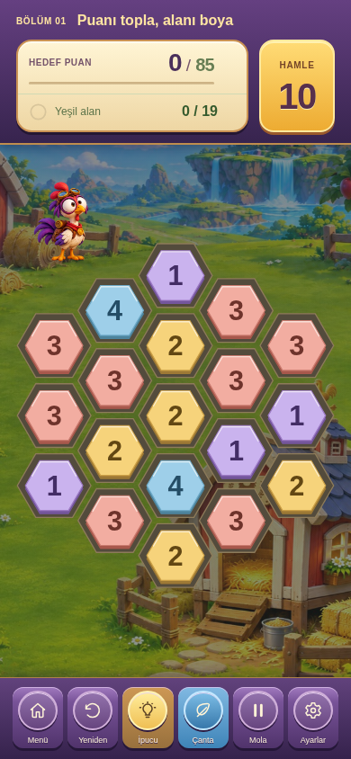
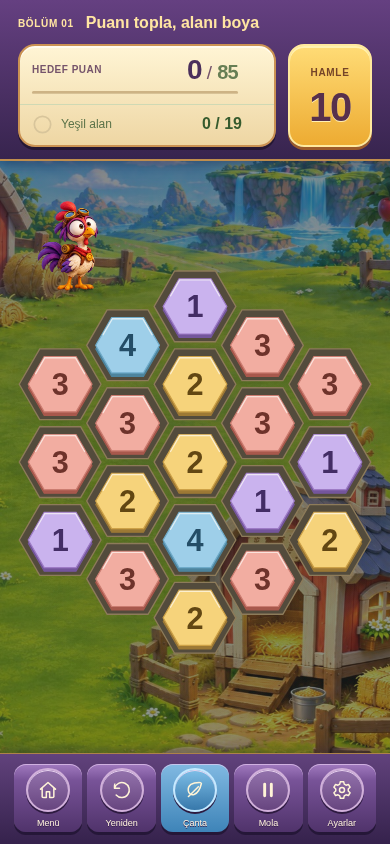

# Smart Idle Hints 9.10 — doğrulama raporu

Taban: PR #32 birleştirildikten sonraki `main`, `616c66389d1aca7c225b56641f27bc901e5a9012`. Dal: `feature/hexrota-smart-idle-hints-9-10`. Bu rapor ilk `beb3371` uygulamasını ve aynı PR üzerindeki, kullanıcı isteğiyle eklenen aralıklı tekrar düzenlemesinin 2026-11-17 tarihli koşumlarını kaydeder; GitHub Actions'ın nihai commit sonuçları teslim PR'ının Checks sekmesindedir.

## Uygulama ve korunmuş sınırlar

- `dist/idle-hints.js`: görünür bilgiyle deterministik çift seçimi, uygun bekleme ve geçici kota. İlk 20 sn; başarılı, kaydedilmiş oyuncu takasından sonra 35 sn; aynı sayfa oturumunda denemeler değişse bile en az 60 sn; attempt başına en fazla iki ayrı öneri döngüsü. Oyuncu giriş yapmazsa aynı çift, 900 ms gösterimin ardından 4 saniye sessiz kalıp yeniden görünür; tekrar aynı ordinal/kotayı kullanır ve 60 saniye zaman damgasını değiştirmez. Reload yeni tam 20 sn bekler.
- `dist/idle-hint-view.js` / `src/styles/09-idle-hints.css`: dekoratif SVG kopyaları, 900 ms / iki küçük hareket; reduced-motion için statik çizgi. Gerçek taş, hücre ve hit-target kimlikleri korunur.
- `dist/app.js`: mevcut state selector/lifecycle bağlantısı, kayıt başarılı olduktan sonra rearm ve başarısız çizimde fail-closed görsel fingerprint. Manuel düğme/H kaldırıldı; eski saf solver ve açık geliştirici tanılama yolu korundu.
- HTML, stil manifesti, toolbar kolonları, PWA v47, test fixture yükleyicileri ve CI tarayıcı adımları güncellendi. Eski kullanıcı istatistikleri ve sözleşmeleri değişmedi.
- Engine, commands, levels/variants, C# kaynakları, save şemaları, ekonomi, can ve rescue kuralları değiştirilmedi. 40 varyant, 80 sertifika ve eski rotalar mevcut testlerle tekrar doğrulandı. Önceki hash fixture'ları değiştirilmedi; yalnız iki yeni offline sunum betiğini kapsayan dar SW overlay'i ve açık `removedIds: ["hint"]` kaydı eklendi.

## Gerçek komut sonuçları

| Koşum | Exit | Kanıt |
| --- | --- | --- |
| `npm test` | 0 | Mevcut bütün zincir ve yeni `test:idle-hints`; state, F-01, animation, solvability, rescue-safety, board-validation, solver-integrity dahil. |
| `npm run test:idle-hints` | 0 | 35 policy + 17 view grubu. Kontrollü saat, gerçek motor/40 başlangıç, hidden-RNG değişmezliği, quota, stale callback, iptal/hata ve kaynak temizliği. |
| `npm run test:idle-hints-browser` | 0 | Gerçek Chromium: 23 grup, sıfır uygulama hatası/dış istek. |
| `HEXROTA_BROWSER=webkit npm run test:idle-hints-browser` | 0 | Gerçek WebKit: 23 grup, sıfır uygulama hatası/dış istek. Linux WebKit wrapper'ı; fiziksel iPhone değildir. |
| `node check-hint-integrity-browser.cjs` | 0 / 0 | Chromium ve WebKit'te 10'ar mevcut Worker/forged-route/timeout/fallback/stale-navigation grubu; yalnız açık geliştirici tanılama transport'u değişti. |
| `node check-integration-browser.cjs` | 0 | 6 Chromium grubu; gerçek PWA offline devam/Worker bağımlılıkları, eski snapshot ve sıfır canla devam. Bu eski suite Chromium'a özgüdür; WebKit diye raporlanmadı. |
| `node check-f01-browser.cjs` | 0 | Yerel Chromium'da 21 gerçek uygulama grubu; tek kanonik yazı, ilk yazı rollback'i, sonuç/ödül/olay tekilliği, reload ve görsel hata. İki tarayıcı CI işi de suite'i korur. |
| `node check-pwa.cjs` | 0 | HTML/Worker/import/CSS v47 tutarlılığı ve offline exact-byte shell kontrolü. |
| `node scripts/check-architecture.cjs`, styles `--check`, `check-comic-ui.cjs` | 0 | 38 runtime syntax dosyası, 10 stil bölümü, 88 korumalı dosya ve mevcut DOM hook'ları; yalnız manuel `hint` ID kaldırıldı. |

`check-ui`, onboarding, game-shell, attempt, inventory, playtest, reward, session-consistency ve state-characterization ayrıca gerçek uygulamayla ayrı ayrı da exit 0 verdi. Eski worker, kayıt hatası, event ve domain assertion'ları kaldırılmadı. Normal boot'ta tanılama adaptörü yoktur; testler onu açıkça boot öncesinde etkinleştirir.

## Gerçek .NET/C# karşılaştırmaları

Bütün komutlar .NET SDK **8.0.428** ile gerçek C# 7.3 kodunu derleyip çalıştırdı; JavaScript fallback kullanılmadı. Ayrıntılı sayılar ve süreler: [`native-parity.json`](../reports/smart-idle-hints-9-10/native-parity.json). On komutun tümü exit **0**, seri toplam 129,506 sn.

| `npm run` | Gerçek karşılaştırma kanıtı |
| --- | --- |
| `test:unity-gameplay` | 1.916 geçerli takas, 258 resume, 262 replay, 1.050 reddedilen core save; ara dalgalar/RNG/falls/refill/katlar dahil. |
| `test:unity-rewards` | 104 ortak vektör + createState factory. |
| `test:unity-catalog` | 2.107 tam JSON karşılaştırması; 80 tam sertifika, 725 seçim, 610 resume. |
| `test:unity-hints` | 1.274 karşılaştırma; 815 garantinin replay'i, malformed/imported/off-route/assisted durumlar dahil. |
| `test:unity-reward-adapter` | 175 rota, 1.456 tur, 2.928 dalga; 1.564 replay/restore kontrolü. |
| `test:unity-lives` | 344 derlenmiş istek; 152 dondurulmuş v1 geçişi ve 460 stress geçişi. |
| `test:unity-session` | 580 event + 1.362 session JSON karşılaştırması; 36 gerçek app akışı, 63 native hata/guard senaryosu. |
| `test:unity-economy` | 125 akış, 579 tam sonuç/durum karşılaştırması. |
| `test:unity-commands` | 2.952 karşılaştırma, 16.051 adım; 80 sertifikalı rota dahil. |
| `test:unity-rescue` | 376 karşılaştırma, 600 native yaşam döngüsü geçişi. |

Bu sayılar birbirinden bağımsız benzersiz test toplamı diye toplanmamalıdır; aynı rotalar farklı sözleşmelerde yeniden doğrulanır.

## Mobil geometri ve gerçek görsel kanıt

İki tarayıcıda da 320×568, 390×844, 430×932, 844×390, 932×430, 1280×720 boyutları incelendi. Her boyutta pinlenmiş tabanın gerçek app/index/style sürümü aynı motora karşı ayrı yüklenir. Önce/sonra board kutusu, SVG hücre koordinatları, floor/gem kimlikleri, doğal dokunma hedefleri ve erişilebilir toolbar kontrolleri eşittir. Yeni beş düğmeli satırda boş ipucu yuvası yoktur.

Ölçülen iki yönlü yaklaşma Chromium'da **2,4999768–2,5000317**, WebKit'te **2,4999788–2,5000317 CSS px**. Vektörler birbirine ters ve komşuya dönüktür; dönüşte displacement sıfırdır. 0/225/450/675 ms native WAAPI örneklerinde PNG piksel farkı yalnız ilgili hücrelerin içinde ayrıca sayılır; yalnız DOM kontrolü değildir. Tam hamle sunumu sırasında başka ipucu oluşmadığı ayrı gerçek animasyon testiyle doğrulandı.

| Önce — 390×844 | Sonra — 390×844 |
| --- | --- |
|  |  |

[İpucu başlangıcı](evidence/smart-idle-hints-9-10/cue-start-390x844.png) · [İlk yaklaşma tepe anı](evidence/smart-idle-hints-9-10/cue-peak-390x844.png) · [Aynı çiftin tekrarı](evidence/smart-idle-hints-9-10/repeat-peak-390x844.png). Her tarayıcıda 37 PNG (toplam 74), ham sonuçlar ve test logları CI artifact'lerinde tutulur. Commit edilmiş özetler: [Chromium](../reports/smart-idle-hints-9-10/browser-chromium.json), [WebKit](../reports/smart-idle-hints-9-10/browser-webkit.json), [kaynak/görsel hash manifesti](../reports/smart-idle-hints-9-10/integrity.json).

## Önemli regresyon kanıtları

- 19.999 ms'de yok, 20.000 ms'de tek yasal komşu çift; gösterme/gizleme boyunca kanonik profil, skor/tur/RNG/zemin/history, ekonomi/envanter/can, `hintsUsed` ve observational kayıtlar aynı. Yeni kanonik yazı **0**.
- Değişmeyen ve kesintisiz uygun tahtada aynı çift 20.000, 24.900, 29.800 ms şeklinde tekrarlanır; her gösterim 900 ms ve aradaki sessizlik 4.000 ms'dir. Tekrar seçim algoritmasını çağırmaz; aynı çift/ordinal ve kayıt byte'ları korunur. Giriş/uygunsuzluk zinciri iptal eder. Başarılı oyuncu hamlesinden sonraki ayrı öneride 35 saniye ve global 60 saniye birlikte uygulanır; attempt kotası iki ayrı döngüdür. Yeni attempt eski callback'i reddeder, fakat yeni döngünün 60 saniyesini aşamaz.
- Gerçek seçili taş/held pointer, Pause/Settings/Inventory, Home, reload, won/lost, active resolving ve booster hedefleme ipucunu engeller. Booster kullanımı yeniden kurmaz. T1/T2 gösterimi değişmez; H ve sahte bir `#hint` DOM eklemek sıradan oyunda solver çalıştırmaz.
- Geçersiz hamlenin doğal bounce animasyonu sırasında ipucu yok; gerçek bitişten itibaren tam 20 saniye başlar. Bu bağlantı eksikliği incelemede bulundu ve iki lifecycle hook'uyla düzeltildi.
- Son redraw özellikle hata verdiğinde committed board/can/ödül kaydı korunur, eski görünen SVG'ye ipucu çizilmez. Gerçek sonraki redraw uygunluğu geri getirir. Animasyon API hatası/rejection/cancel yalnız dekorasyonu kaldırır.
- Odak dinleyicisi yalnız `event.target===window` için pencere blur/focus'u kabul eder; butonlar arası focus hareketinin idle sistemini kalıcı kapatması engellendi.

## Test metodunun sınırları ve başarısız ilk denemeler

Yalnız yeni idle policy'nin dependency saati/timer'ları kontrollüdür; global Date, gerçek motor, localStorage, input ve browser timer'ları değiştirilmez. Bu nedenle testler her senaryoda 20 saniye uyumaz. Native cue animasyonları yalnız piksel örneği alırken pause/seek edilir; hareketin gerçek CSS/SVG sonucu ölçülür. Visibility ve persisted pagehide teslimleri **sentetiktir**, native BFCache kanıtı değildir; gerçek reload ayrı testtir.

İlk smoke koşumları eski yardım metnindeki H kısayolunu ve window capture dinleyicisinin çocuk blur olayını ayırt etmediğini yakaladı; uygulama düzeltildi. Sonradan native view timer'ının 900 ms'de temizleyebildiği halde fake policy saati 899 ms'de DOM'un hâlâ var olmasını isteyen test assertion'ı düzeltildi: iki farklı saati eşitlemek yerine policy'nin `elapsed` bitişi tam 900 ms'de, view temizliği kendi native/fake-adapter kontrollerinde doğrulanır. İlgisiz domain/piksel/geometri assertion'ları gevşetilmedi. Son kapsamlı 23+23 koşumu başarılıdır.

Fiziksel iPhone/Android, mobil Safari cihazı, Unity/IL2CPP ve native BFCache test edilmedi. Node'da 40 başlangıç üzerinde 1.000 yasal-liste + görünür sıralama örneği p50 **0,0773 ms**, p95 **0,3072 ms**, max **1,7288 ms**; tüm snapshot'lar eşit kaldı. Bu bir mobil FPS, batarya veya önce/sonra performans artışı iddiası değildir. [Ölçüm kapsamı](../reports/smart-idle-hints-9-10/selection-measurement.json).

Mevcut 15 CI job tanımı / matrisle 17 iş korunmuştur. Mobil Chromium/WebKit işlerine yeni suite ve artifact eklendi; pinlenmiş mobil baseline shallow checkout'ta ayrıca fetch edilir. Preview/CI URL'leri PR açıklamasında paylaşılır; bu görev main'e merge veya Production dağıtımı içermez.

## Aynı PR'daki tekrar düzenlemesi

Kullanıcı geri bildirimiyle ilk sürümdeki “aynı tahta değişmeden tekrar görünmesin” beklentisi kaldırıldı. Yeni sözleşme, kesintisiz beklemede aynı önerinin kısa ve ayrı gösterimlerle dönmesidir. İki döngülük kota ile tekrar edilen fiziksel görünmeler testlerde ayrı sayılır; etkileşim/kimlik/iptal testleri hâlâ **bütün fiziksel görünmeleri** sayar. Bu nedenle eski callback hatası, yalnız yeni döngüleri sayan bir testin arkasına saklanamaz.

Ek 16 policy grubu; 4 saniye sınırı, aynı immutable pair/ordinal, quota/chooser/60 saniye zaman damgasının korunması, visible/quiet iptaller, reentrant callback, eski timer nesilleri, gecikmiş wake sırasında burst oluşturmama ve uzun/0-süre yapılandırmalarını doğrular. Yedi yeni tarayıcı grubu ve mevcut altı görsel grubuna eklenen tekrar piksel kontrolleri; klavye/touch iptali, repeat sırasında gerçek hamle, pause/hidden/Home/attempt değişimi, stale teslim, booster ve reduced-motion tekrarını sınar.

Mevcut bölüm, motor, ekonomi/can/rescue ve kayıt kaynaklarında değişiklik yoktur. Yerel native karşılaştırma JSON'u ilk `beb3371` koşumunun tarihli kanıtını korur; güncel PR CI'si aynı 10 C# komutunu gerçek .NET ile yeniden derleyip çalıştırır. Önceki CI sonucu yeni commit için başarı diye kullanılmaz.
