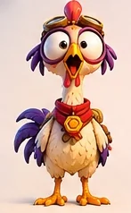

# Tavik — onaylı karakter referansı

15 Kasım 2026 tarihinde kullanıcı, `3E32B9C1-DEED-45BA-B75A-2910301426D6.jpeg` isimli paftayı açıkça onayladı. Önceki Piko/Tavut ve diğer alternatifler bu onayın yerine geçmez.

## Değişmeyecek kimlik

Karakterin adı **Tavik**. İri beyaz gözler, mor tüyler, krem gövde, kırmızı ibik, turuncu gaga/ayaklar, kahverengi-altın gözlük, bordo fular, kahverengi sırt çantası ve altıgen kolye kaynak paftaya göre korunur. Kullanıcı yeni bir tasarım istemedi: mevcut karakteri yeniden çizme veya başka bir karakterle değiştirme.

## Bu teslimatta kullanılan görsel

`dist/assets/characters/tavik/front.webp`, onaylı paftanın ön görünüşünden doğrudan alınmış 147×238 piksellik kırpımdır. Yeni poz, şeffaf zemin veya yeniden üretilmiş çizim değildir; paftadaki açık renk zemin korunur. Küçük arayüz portresi için hazırlanmıştır, yüksek çözünürlüklü Blender/3D kaynak modeli değildir.

Tam kullanıcı kaynak paftası: 1536×1024 JPEG, SHA-256 `11fa0f48269f01066109d2cd903f506308851bb292bbfff55d96d54c5ed16e1c`. Kaynak kimliği, kırpma koordinatları ve çalışma dosyasının hash'i `data/tavik-approved.json` içinde sabittir. Gelecekte yüksek çözünürlüklü görseller hazırlanırken bu onaylı kaynak esas alınır; eksik açıların var olduğu veya bir Blender modelinin hazır olduğu iddia edilmez.

## Uygulama kapsamı

Ana menüde isimli karakter portresi ve UI kitindeki açık macera kitabının yanında Tavik bulunur. Hikâye kartı hâlâ açıkça etiketli bir tasarım örneğidir. Bahçe→çizgi roman ilerleme geçişi, yıldız eşikleri, kayıt, Altın, can, güçlendirici ve bulmaca kuralları bu değişiklikte yapılmaz.

`PR #18` sunum dalında çalışılır. Kullanıcı ayrıca yayın onayı vermeden main/Production değiştirilmez. Karakterin kullanıcı tarafından onaylanması hukuki uygunluk veya marka tescili incelemesi yerine geçmez.

## Kontrol

`check-tavik-assets.cjs` kaynak kimliğini, dosya boyutunu/hash'ini, gerçek WebP başlığını, yerel bağlantıları ve çevrimdışı MIME doğrulamasını denetler. Chromium/WebKit tema testi dört ekran boyutunda resmin gerçekten yüklendiğini ve okunabilir alan içinde kaldığını denetler. Fiziksel telefon testi ayrıca gerekir.
