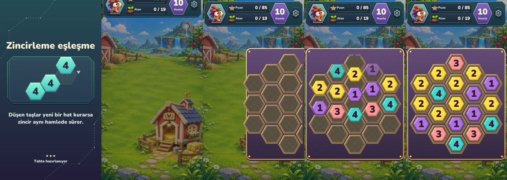
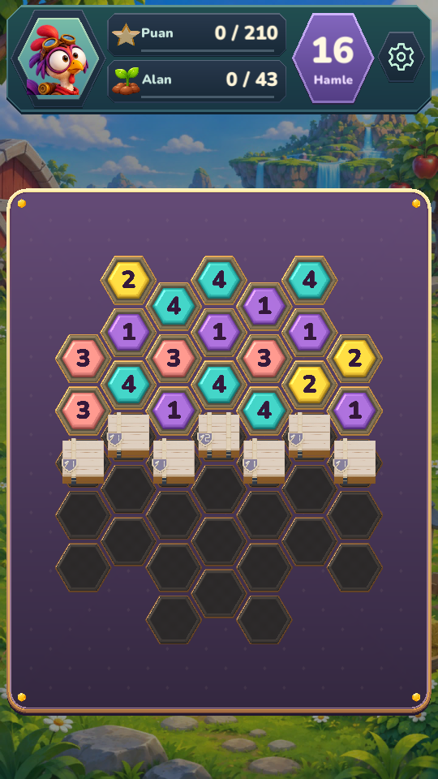
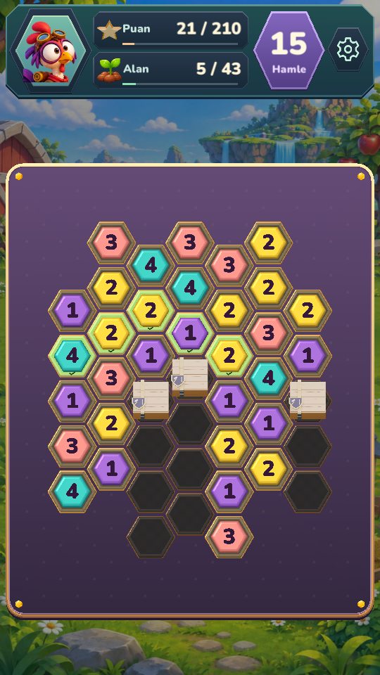

# Unity bölüm girişi ve 9×9 kampanya tahtası

Unity 6000.6.9f1 Editor’da `FirstPlayable` sahnesi ve gerçek oyun oturumu kullanıldı. Dikey oyun görünümü 540×960 ve 360×780 boyutlarında kontrol edildi. Testler geçici bir oyuncu profiliyle çalıştı.

## Giriş ve ekran düzeni

Bilgi kartı açılır, 2,25 saniye okunabilir hâlde kalır ve kapanır. Ardından üst panel yukarıdan iner, tahta sağdan yerleşir ve taşlar sütunlarının açık kısımlarına yukarıdan düşer. Taşlar yerleşince ilk takas yapılabilir. Azaltılmış hareket seçiminde bilgi kartı sabit görünür ve tahta dolu açılır. Arka plana geçiş ve geri dönüş aynı denemeyi sürdürür.

540×960 kaydında öğreticiden Bölüm 1’e geçiş ve ilk takas birlikte görülebilir. [10 saniyelik Editor kaydını izle](bolum-girisi.mp4)

Üst panelde Tavik, puan ve yeşil alan hedefleri, kalan hamle ve ayarlar bulunur. Panel düzeni ve çizimleri [CastleHud prefabında](../../unity-client/Assets/Hexrota/Resources/CastleGame/CastleHud.prefab) düzenlenebilir. Bilgi başlıkları, açıklamalar ve her birinin şekilleri [ChapterLoading prefabında](../../unity-client/Assets/Hexrota/Resources/CastleGame/ChapterLoading.prefab) ayrı öğelerdir.

## Kampanya ve kayıt

T1, T2 ve ilk beş bölüm kendi şekillerinde açılır. Yeni Bölüm 6–10 denemeleri 9×9 alanda sırasıyla 43, 49, 53, 61 ve 65 gerçek hücre kullanır. Şeklin dışına dokunmak hamle harcamaz. Kasa arkasındaki zemin başlangıçtan itibaren hedefe dahildir ve sütunun yolu açıldığında taş alır. [Git geçmişindeki 9.12 bölüm tasarımı](../../docs/LARGE_BOARDS_9_12.md)

| Bölüm 6 açılışı | İlk takastan sonra |
| --- | --- |
|  |  |

Bölüm 6’da 5 numaralı hücreden 13 numaralı hücreye sürükleme 4 kasayı kırdı ve 13 hücreyi açtı. Puan 0’dan 21’e, yeşil alan 0/43’ten 5/43’e çıktı. Kampanya testleri eski klasik bölüm ve 23 hücreli Bölüm 6 kayıtlarını kendi düzenlerinde tekrar açtı. Engelli tahtaların yardım ve kurtarma seçenekleri web sürümündeki kuralları izliyor.

## Test sonuçları

| Kontrol | Sonuç |
| --- | --- |
| Unity Editor EditMode | 41 test geçti |
| Unity Editor PlayMode | 56 test geçti |
| Gerçek Editor görüntüsü ve sürükleme | Her iki portre boyutunda Bölüm 1’de 19 taş yerleşti. İlk takasta puan 0’dan 13’e çıktı, hamle 10’dan 9’a indi. |
| Tahta verisi ve kayıt | Beş geniş bölümün 10 doğrulanmış çözümü, eski bölüm kimlikleri ve kapalı hücrelerin kayıt sonrası durumu doğrulandı. |
| Kaynak senkronizasyonu | 34 C# kaynağı ve 15 kanonik JSON dosyası Unity kopyalarıyla bayt düzeyinde eşleşti. |

Doğrulama Editor’da yapıldı. Fiziksel telefonda test yapılmadı ve oyuncu build’i alınmadı.
