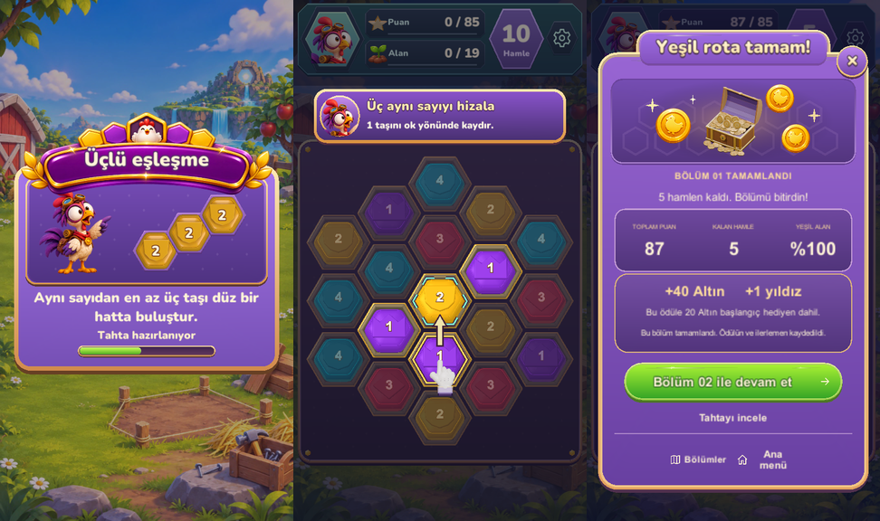
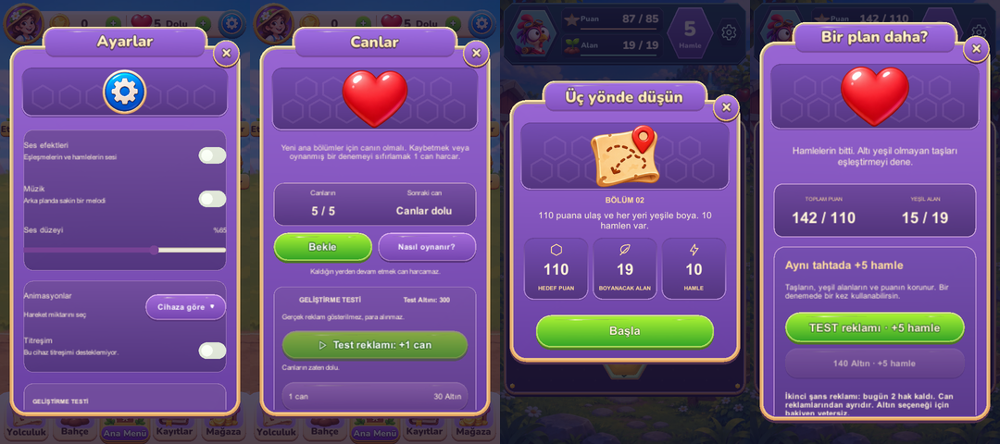

# Unity pencereleri, bölüm girişi ve ilk tahta

## Bölüm 1

Dört yeni açılışın her birinde 19 hücre ve dört sayı var. Her sayı 4 veya 5 defa kullanılıyor. Taşlar yerleştiğinde hazır bir eşleşme yok. İlk yönlendirme, oyuncunun taşıyacağı taşı, hedef hücreyi ve çizgiyi tamamlayan iki taşı aydınlatıyor. Takas tam üç taşı eşleştiriyor ve ilk düşüşten sonra zincir başlamıyor. İkinci hamleyi oyuncu serbestçe seçiyor.

Editör kaydındaki açılışta oyuncu mor 1’i sarı 2’nin yerine kaydırdı, üç tane 1 eşleşti ve sayaç 3 puan arttı. Tahta aynı denemede kazanıldı ve sonuç düğmesinden Bölüm 2 açıldı.

Yeni Bölüm 1 denemeleri `chapter-one-v1` düzenini kullanır. Her düzenin farklı ilk hareketlerle başlayan iki kazanma yolu gerçek motorla doğrulandı. Önceden kaydedilmiş Bölüm 1 başlatıldığında aynı deneme kimliği, taşlar ve rastgele sayı üretecinin durumu geri yüklenir. Eski bir tahtada henüz hamle yapılmamışsa rehber o düzenin üçlü eşleşmesine işaret eder. [Açılışlar ve kazanma yolları](../../data/chapter-one-openings-v1.json)

## Ekranlar

Yükleme kartının arkasındaki kümes, kaydedilmiş ilerlemeye göre değişir. Tavik, taşlar, rakamlar, arma, metinler ve yeşil gösterge ayrı Unity öğeleridir. Standart hareket seçiminde kart açılıp kapanır ve ardından üst panel, tahta ve taşlar sahneye girer. Azaltılmış harekette kart ve gösterge sabit kalır. [Yükleme prefabı](../../unity-client/Assets/Hexrota/Resources/CastleGame/ChapterLoading.prefab)

Ayarlar, canlar, yardım, mola, yeniden başlatma onayı, çanta ve satın alma, bölüm önizlemesi, sonuç ve kurtarma ekranları ortak pencereyi kullanır. Başlık, mor yüzey, altın çerçeve, kapatma düğmesi ve düğme stilleri prefabda düzenlenir. Ödül sandığı oyuncunun sağladığı `hexrota_shop_v01` paketinden gelir. [Pencere prefabı](../../unity-client/Assets/Hexrota/Resources/CastleGame/CastlePopup.prefab)

## Unity Editor doğrulaması

### Yükleme prefabının yeniden içe aktarılması

`9ad3e31` sürümünde testler geçtiği halde Editor günlüğü yükleme göstergesinin iki çocuk bağlantısı için hata kaydetmişti. Yeni EditMode testi prefabı yeniden içe aktarır ve Unity'nin o dosyaya ait içe aktarma günlüğünü kontrol eder. Unity 6000.6.9f1'de eski dosyayla aynı test iki `Transform child can't be loaded` hatasını yakaladı. Çocuk listelerindeki iki boş satır kaldırılınca aynı test geçti. [Prefab regresyon testi](../../unity-client/Assets/Hexrota/Tests/EditMode/CastleGameplayAssetTests.cs)

Sıfırdan oluşturulan bir Library ile yerel projenin ayarlarında 51 EditMode testi geçti. İçe aktarma ve derleme günlüğünde bildirilen `UAC1001`, `UAC1009` ve `CS0618` uyarıları görülmedi. Kayıt testi, boş hücreler ve iki hamle içeren eski bir kaydın JSON olarak okunup aynı içerikle tekrar yazıldığını doğruladı. [Kayıt regresyon testi](../../unity-client/Assets/Hexrota/Tests/EditMode/MainResourceImportTests.cs)

PR'daki ayarlarla 51 EditMode ve 63 PlayMode testi geçti. Ek bir 540×960 GameView koşusunda Oyna düğmesinden Bölüm 1 açıldı, gösterilen takas üç taşı eşleştirdi, bölüm kazanıldı ve Bölüm 2'ye geçildi. Build alınmadı.

### Pencere ve tahta teslimindeki kontroller

Unity 6000.6.9f1 üzerinde 49 EditMode ve 63 PlayMode testinin tamamı geçti. Düğme okunun son yerleşim ayarından sonra dört pencere testi ve iki çözünürlükteki görüntülü oyun akışı ayrıca geçti. [Editor test sonuçları](editor-tests.json)

540×960 ve 360×640 GameView koşularında menüden ayarlar ve can pencereleri açılıp kapatıldı. Oyna düğmesiyle Bölüm 1 açıldı. Rehber kartının hiçbir taşın merkezini kapatmadığı kontrol edildi. İlk takas ve kazanan hamleler sürükleme girdisiyle oynandı. Bölüm 2 önizlemesinden oyuna geçildi ve hamleler tükendiğinde kurtarma penceresinin açıldığı doğrulandı. Görüntüler bu koşularda alındı.

Kaydırma testi, uzun ayar penceresinin içeriği hareket ederken sağ üstteki kapatma düğmesine dokunulabildiğini ve bölüm önizlemesinin aynı çerçeveyi kullandığını kontrol eder. [PlayMode regresyon testi](../../unity-client/Assets/Hexrota/Tests/PlayMode/MobileProgressPanelsTests.cs)

Kaynak kontrolünde 34 C# dosyası ve 16 JSON belgesi kanonik kaynaklarıyla bayt düzeyinde eşleşti. Editor koşuları ayrı proje kopyalarında, mevcut dalın sürüm kontrollü paket ve proje ayarlarıyla çalıştırıldı. Fiziksel cihaz testi yapılmadı. Oyuncu build’i alınmadı.
