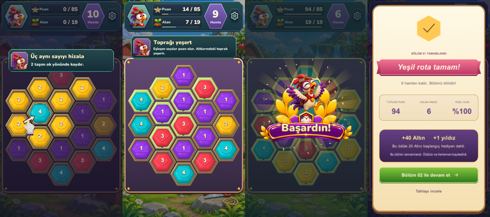

# Bölüm 1 öğreticisi ve Tavik kutlaması

Bu kayıt ilk öğretici teslimini (`6bc45f9`) gösterir. Sonraki çalışmada Bölüm 1 açılışları, pencereler ve yükleme ekranı güncellendi. [Güncel oyun görüntüleri ve doğrulama](../unity-castle-windows/DOGRULAMA.md)

Yeni profilde ana menüde **Oyna** seçilince Bölüm 1’in seçilen varyantı açılır. Tavik ilk gerçek takasın yönünü gösterir. İlgili taşlar aydınlık kalır ve el işareti kaynak taştan hedefe ilerler. Kaydırma ve iki taşa sırayla dokunma desteklenir. Başka bir çift seçmek hamle harcamaz.

Doğru takas oyuna kaydedilir. Eşleşme oynatılır ve Tavik sayıların puana eklendiğini, altlarındaki toprağın yeşerdiğini açıklar. Oyuncu aynı tahtada sonraki hamlesini serbestçe yapar. Arka plandan ve kayıttan dönüşte tahtanın kimliği ve yapılmış hamleler korunur.

Unity 6000.6.9f1 Editor’da 540×960 portre görünümünde kaydedilen oyunda ilk takas 14 puan kazandırdı, 7 hücreyi yeşertti ve 9 hamle bıraktı. Dördüncü hamlede oyuncu 94/85 puana ve 19/19 yeşil hücreye ulaştı. Puan uçuşunu Tavik’in kutlaması ve ödül kartı izledi. Sonuç düğmesinden Bölüm 2 açıldı. [Oyun kaydından kısa kesitler](bolum-1.mp4)

## Yeni mekaniklerin ilk göründüğü bölümler

| Bölüm | Oyuncunun gördüğü açıklama | Editor görüntüsü |
| --- | --- | --- |
| 3 | Çift katlı zemini açmak için aynı hücrede iki kez eşleşme yap. | [Çift katlı zemin](bolum-3-zemin.png) |
| 6 | Kasanın yanında eşleşme yap. Kasa kırılınca taşlar açılan sütuna düşer. | [Kasalar](bolum-6-kasalar.png) |
| 8 | Yeni 5 taşlarından en az üçünü bir çizgide eşleştir. | [5 taşı](bolum-8-tas.png) |

Kartlar dokunuşu engellemez. İçerik kayıtlı tahtanın gerçek özelliklerine göre seçilir. Örneğin eski, kasasız Bölüm 6 kaydı açıldığında kasa kartı gösterilmez.

## Doğrulama

| Ortam | Sonuç |
| --- | --- |
| Unity 6000.6.9f1 EditMode | 48/48 geçti. Dört Bölüm 1 varyantı, kayıt geri yükleme, başarısız ödül yazımından sonra yeniden deneme ve eski öğretici kayıtları kapsandı. |
| Unity 6000.6.9f1 PlayMode | 17 test sınıfında 62/62 geçti. Hiçbir test atlanmadı. [Test sonuçları](editor-tests.json) |
| Editor GameView, 540×960, Radeon RX 9070 XT | Ayrı giriş ve görüntü testinde gerçek UI düğmeleri ve tahta sürüklemeleriyle başlangıçtan Bölüm 2’ye geçildi. Bölüm 3, 6 ve 8 açıklamaları da görüntülendi. |
| Kaynak ve sahne kontrolleri | 34 kanonik C# dosyası ve 15 JSON senkron. Altı proje ve sahne kontrolü, dokuz görsel sözleşme grubu ve altı Chromium ekonomi izolasyonu grubu geçti. |

Koşumlar geçici profillerle ve 590 proje dosyası doğrulanmış Editor kopyalarında yapıldı. Fiziksel telefon testi yapılmadı. Build alınmadı.

## Kayıt, ödül ve sunum

- **İlk bölüm.** İlk hamleden önce geri dönüldüğünde aynı kayıt ve aynı yönlendirme açılır. Henüz hiç eşleşme yapmadan baştan başlayan oyuncuya yeni tahtasının takası gösterilir. İlk eşleşmesini yapmış oyuncu serbest devam eder.
- **Eski profiller.** T1/T2 kayıtları özgün kimlikleriyle okunabilir. Yeni kampanya akışı bu dersler için tamamlanma kaydı yazmaz. Başlangıç hediyesi ve bölüm ödülü gerçek kazanma hamlesiyle birlikte kaydedilir. Güncel yeni profilde ilk zafer 20 bölüm altını, 20 başlangıç altını ve 1 yıldız verir. Eski başlangıç hediyesi tekrar ödenmez.
- **Kutlama.** Son puan hedefe ulaştıktan sonra Tavik, altın yapraklar ve “Başardın!” kurdelesi gösterilir. Dokunmak sonuç kartını açar. Azaltılmış hareket seçimi sabit rozet gösterir. Tahtayı yeniden incelemek ve kayıtlı sonuca dönmek ikinci kutlama başlatmaz.
- **Unity’de düzenleme.** Tavik portresi, yön oku, el, metinler ve kart görünümü öğretici prefabında düzenlenebilir. Kutlama rozeti, karakter, ışınlar, kurdele, başlık ve süreler ayrı öğelerdir. [Öğretici prefabı](../../unity-client/Assets/Hexrota/Resources/CastleGame/CastleGameTools.prefab) · [Kutlama prefabı](../../unity-client/Assets/Hexrota/Resources/CastleGame/ChapterVictory.prefab)

Görsel referans olarak kullanıcının paylaştığı iki oyun karesi incelendi. Fandom sayfasındaki GIF’e erişim engelliydi. Hedefler, üçlü eşleşme ve sınırlı hamle akışı resmî oyun açıklamasıyla karşılaştırıldı. [Royal Match Help Center](https://dreamgames.helpshift.com/hc/en/3-royal-match/faq/4-how-can-i-play-the-levels/)
