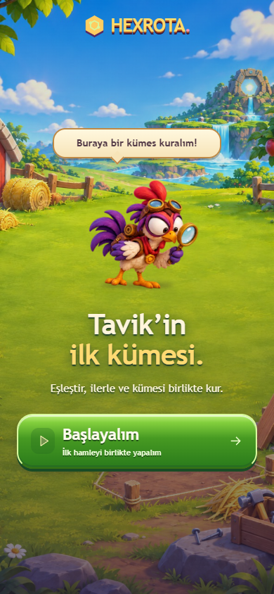
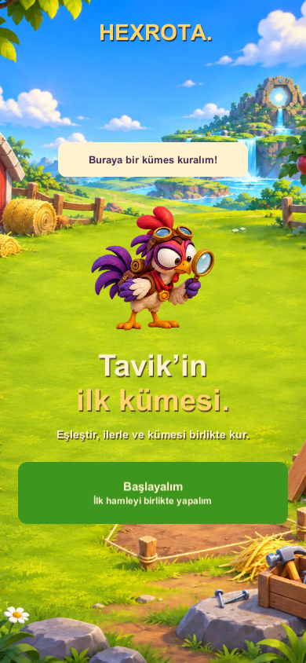
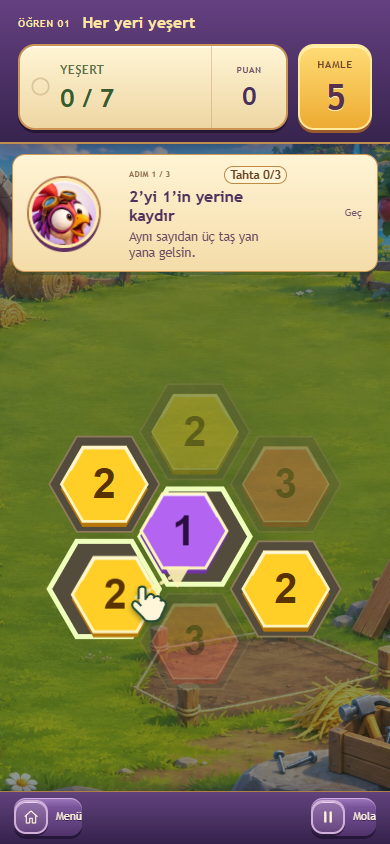
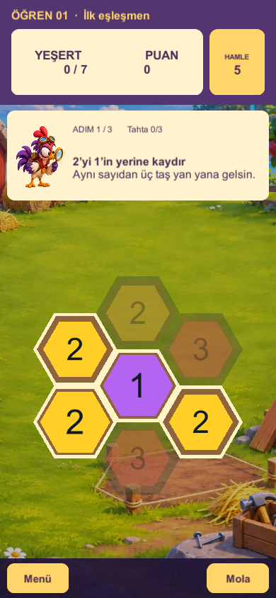
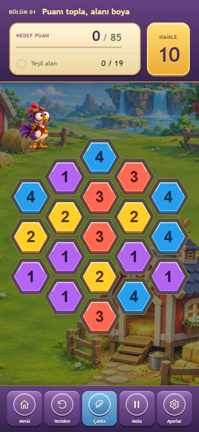
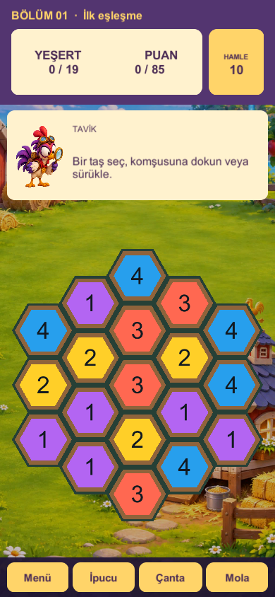

# Portre ekran karşılaştırması

Her görüntü 390 × 844 piksel. Solda yerel Chrome’da açılan `main` Web uygulaması, sağda Unity FirstPlayable sahnesi bulunur. Her iki istemcide de yeni profille “Başlayalım” düğmesinden ilk öğreticiye girildi. Bölüm 1 karşılaştırmasında Web kaynağı [b078da4](https://github.com/kiviman1/hexrota/commit/b078da49a0a1c9632195f13aefefad812e7f92ab), Unity çalışma ağacının oyun kodu [2bfbabd](https://github.com/kiviman1/hexrota/commit/2bfbabd20c18649ad4992f130bf4b22382b9e33d).

| Oyuncunun gördüğü | Web | Unity |
|---|---|---|
| İlk açılış |  |  |
| T1, ilk hamleden önce |  |  |
| Bölüm 1, iki öğreticiden sonra, ilk hamleden önce |  |  |

**İlk açılış.** İki ekran da aynı foundation manzarasını, Tavik’in onaylı inspect pozunu, kümes cümlesini, başlığı ve yeşil başlama kontrolünü aynı sırada gösteriyor. Unity’de yazı, altın logo, balonun ucu, alt kararma, CTA ikonu, kenar ve gölgelendirme Web’den farklı.

**İlk öğretici.** İki görüntüde de yedi gerçek hücre, aynı taş sayıları ve yerleşim, başlangıç puanı 0, hamle 5 ve yeşeren alan 0/7 görülüyor. İlk hamlede aynı konumdaki taşlar vurgulanıyor, diğer taşlar soluk. İki koç da Adım 1/3, Tahta 0/3, “2’yi 1’in yerine kaydır” ve aynı ders açıklamasını gösteriyor. Web’de portre yuvarlak ve kırpılmış, öğretici dokunuşu animasyonlu, Geç erişilebilir ve alt çubukta ikonlar var. Unity’de düz kart kenarları, farklı taş/etiket oranları ve HUD tipografisi görülüyor.

**Bölüm 1’e ulaşma.** Web’de Chrome’un dokunma olaylarıyla, Unity’de sahne denetleyicisinin takas ve koç onayı komutlarıyla T1’in üç, T2’nin dört hamlesi oynandı. Her iki istemci de galibiyetlerden sonra Bölüm 1’e geçti. Web’de bölüm önizlemesindeki başlama düğmesi de kullanıldı. Web profilinin ilk varyant seçim tohumu `3746266212`, izole Unity oturumunun kurucusuna verildi. Bölüm açıldığında iki kayıt dosyasının deneme kimliği, tahta anlık görüntüsündeki tüm alanlar ve altın bakiyesi karşılaştırıldı ve eşit çıktı. Deneme `a-1-3-a83324e7`, varyant `v4`, kural `classic-v4`, rastgele sayı üreteci durumu `3386005712` ve bakiye 20 altındı. [Karşılaştırılan kayıt alanları](level-one-snapshot.json)

**Bölüm 1’in görünümü.** Her iki ekran aynı renk ve sayı diziliminde 19 taş, 0/85 puan, 0/19 yeşeren alan ve 10 hamle gösteriyor. Unity’de Tavik’in geniş yardım kartı nedeniyle tahta daha aşağıda. Web’de üst başlık “Puanı topla, alanı boya”, hedef göstergesinde ilerleme çubuğu ve alt sırada beş ikon var. Unity “İlk eşleşme” başlığını, yatay hedef sayaçlarını ve dört metin düğmesini gösteriyor. “Yeniden” ve “Ayarlar” Web’de doğrudan bu sıradan erişilebiliyor. Bu kareler Bölüm 1’in başlangıç durumunu karşılaştırır. Takas animasyonunun ve sonuç ekranlarının doğrulanması ayrı testler gerektirir.

**Yakalama ortamı.** Web yakalaması Chrome’un 390 × 844 mobil görünümünde, piksel oranı 1 ile yapıldı. Unity 6000.6.9f1 (8c45277fb9c5), Windows Standalone x64 / Mono, Direct3D 11 ve Radeon RX 9070 XT kullanıldı. İzole proje kopyasında geçici yakalama bileşeni gerçek sahneyi açtı ve etkin bölümü denetledi. Gizli oyuncu penceresinin doğrudan framebuffer okuması siyah döndüğü için aynı sahnenin arka plan, tahta ve tam Canvas çıktıları GPU ile 390 × 844 RenderTexture’a çizildi. Overlay Canvas yakalama sırasında ekran kamerasına yönlendirildi. Tahta viewport’u ve UI ölçüleri korundu. Görüntülerde renk çeşitliliği denetlendi ve kareler gözle incelendi. Fiziksel telefon ve dokunma gecikmesi bu karşılaştırmanın dışında.
